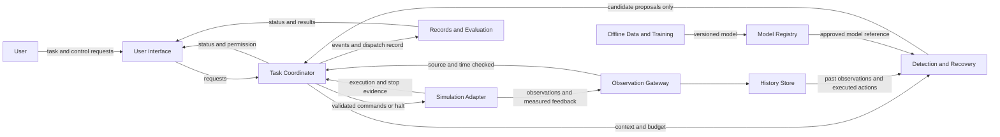
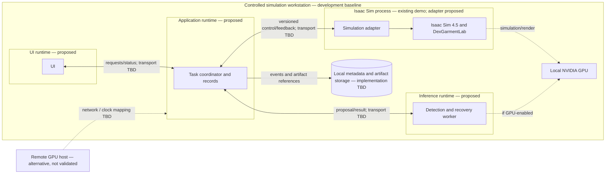

# Assignment 2: System Architecture — Presentation Draft

Prepared for Zhang Mingbo's section; 8 November 2026. **Draft for team integration and review, not evidence of a deployed end-to-end system.** The diagrams below are editable Mermaid source. Slides are due before **9 November 2026, 13:30 Asia/Shanghai**; actual upload, rehearsal and attendance are not yet recorded.

Source baselines: [presentation plan](presentation-plan.md), [system and recovery interfaces](interfaces.md), [recovery design](recovery-design.md), [control and scoring decision](decisions/ADR-MA-001-control-and-scoring.md), [simulation platform decision](decisions/ADR-MA-004-simulation-platform.md), and [environment evidence](../research/zhangmingbo/environment-feasibility.md). The English SRS remains the acceptance baseline.

Execution update, 8 November 2026: Ma Xianghui confirms that he has rerun the existing setup on Zhang Mingbo's workstation. This basic rerun item is closed. Subsequent simulation, collection and recovery experiments use that workstation; a second installation or repeated basic rerun is not required. See the [shared execution arrangement](../research/shared-simulation-workflow.md). New control, stop and recovery capabilities still require their own validation.

## Slide 3 — Logical architecture



**Responsibility and authority:** The UI requests actions and displays state; the coordinator decides task state and owns dispatch authority; the adapter executes accepted commands and reports measurements; detection/recovery proposes actions without direct dispatch rights. Record and evaluation preserve evidence separately from the control path. Offline training and model management are isolated from online authorization. Observation provenance and history gaps are recorded; unknown or privileged inputs are not silently treated as deployable camera data.

**Trade-off:** Central authorization and versioned interfaces make competing control requests and stale results checkable, at the cost of additional checks and communication latency. A simpler policy-to-adapter connection removes those checks and conflicts with the existing control baseline. The sequence and actual stop latency still require implementation and measurement.

## Slide 4 — Deployment and technology architecture



The author's Windows workstation has run an Isaac Sim 4.5 / DexGarmentLab Fold Tops demonstration with a low-resource profile. The adapter, coordinator, UI and worker deployment and their connections are **proposed**; their placement, network transport, persistent storage, and remote GPU compatibility have not been demonstrated. Logical components need not each be a separate operating-system process. Simulation and inference may contend for the same GPU: measure memory, throughput and latency before deciding whether to co-locate them.

| Concern | Baseline / decision status | Alternative and reason for comparison | Cost / verification |
|---|---|---|---|
| Simulation | Isaac Sim 4.5 and DexGarmentLab on Zhang's workstation; the leader confirms the basic rerun is complete | Replace cloth platform if assets, stability or control access prove inadequate | Continue checking stability and physical effects of reduced contact budgets; no second-machine installation requirement. |
| Runtime | Isaac's Python 3.10 and its NumPy/Torch remain isolated; separate application/inference environments proposed | One shared Python environment is simpler but risks conflicting Isaac dependencies | Verify versioned data exchange and profile compatibility; no complete adapter yet. |
| Communication | Versioned logical messages; concrete transport and deployment **TBD** | In-process calls reduce overhead; IPC/network isolates failures but adds serialization and timeout handling | Test latency, stale observations, reconnection, duplicate commands and clock mapping. |
| Persistence | Separate small metadata/events from referenced large artifacts; engine/storage technology **TBD** | Database or atomic local files; choose after durability and deployment tests | Validate atomic dispatch-intent writes and recovery after interruption; write failure blocks new dispatch. |
| Model | Replaceable recovery proposal interface; scoring/calibration remains unverified | Fixed rules for diagnosis versus trained model; no uncalibrated score as probability | Compare under the same observations and budgets; online use requires gates and calibration. |
| Remote compute | Deferred, no A800 or remote deployment test | Local work avoids rental setup; remote compute may provide resources | Before use test GPU/render compatibility, remote clocks, network failures, stop feedback, cost and resource release. |

**Network, stopping and resource boundaries:** Loss of a UI or worker connection must not restore old authority or allow stale decisions; the coordinator rejects unavailable/expired results and initiates the applicable stop/help path. A halt request is not proof of rest: require fresh measured stop evidence and keep the lock on timeout. Remote resource release requires an actual acknowledgement; monitoring costs must include waiting and failure paths. These are design requirements, not measured guarantees.

## Backup — Core interaction and exceptional paths

```mermaid
sequenceDiagram
  participant U as User / UI
  participant C as Task Coordinator
  participant R as Recovery Worker
  participant L as Event Store
  participant A as Simulation Adapter
  U->>C: Start request with idempotency key
  C->>C: Validate state, profile, versions and authority
  alt Accepted
    C-->>U: Task ID and current state
    C->>A: Dispatch authorized normal segment
    A-->>C: Measured feedback and observation reference
    C->>R: Request proposal with current generation and budget
    R-->>C: Candidates or unavailable
    alt Valid, fresh, authorized and within budget
      C->>L: Persist acceptance / command ID
      L-->>C: Stored
      C->>A: Dispatch accepted segment
      A-->>C: Execution feedback; reobserve
    else Stale, invalid, no calibrated candidate or timeout
      C->>C: Reject; reobserve or stop and request help as required
    end
  else Invalid state or duplicate request
    C-->>U: Reject or return prior disposition
  end
  U->>C: Pause / terminate / handover request
  C->>C: Revoke old generation; cancel pending decisions
  C->>A: Request halt
  A-->>C: Fresh measured rest evidence or timeout
  C-->>U: Confirm permitted state or keep stop lock
```

The diagram describes intended behavior. Canceling a worker or receiving an ACK does not prove physical rest. Accepted attempts retain their accounting; old results never regain authority. Resume and manual return have different prerequisites; manual return first revokes manual authority and requires new stop evidence and the applicable validation. Replay is read-only. Model activation is allowed only in the permitted idle state and must retain the previous version on rejection. Full conditions and thresholds remain in the SRS and [interfaces](interfaces.md).

## Backup — Risks and validation

| Open risk | Evidence to obtain / decision criterion | Fallback |
|---|---|---|
| Host RAM and reduced physics budgets | Repeat fixed-profile operation with memory/GPU traces and contact/physical anomalies; compare with a higher-resource configuration if available | Limit scope or reassess deployment/platform; do not report a single True as stability. |
| Unknown channel mapping, source and timing | Capture runtime DOF names/indices/types/units, command/feedback association and real clock domains; audit camera/point-cloud provenance | Keep offline data isolated; reject unsupported online profiles. |
| Stop and state reset unproven | Measure feedback, velocity and queue after stop; assess cloth, robot, velocity and contact state reproducibility | Keep stop lock and request help; if exact reset unavailable, quantify differences and restrict comparisons. |
| Uncalibrated recovery scoring | Establish calibration and input compatibility on validation data before authorizing thresholds | Use isolated offline ranking / demonstrative test stub; no score-to-probability conversion. |

## Speaker notes — about 135 seconds, to be timed

**Slide 3, target 65 seconds:** “Our logical design separates user requests, task coordination, simulation, recovery and evidence. The coordinator owns the right to dispatch. The recovery module receives observations and history and proposes bounded actions; it cannot directly control the simulator. Before dispatch, the coordinator checks authorization, timing, versions and budget and records the decision. This adds checks, but it makes stale or competing control requests easier to reject and allows us to replace the recovery method.”

**Slide 4, target 70 seconds:** “For deployment, the current development baseline is one controlled workstation with Isaac Sim 4.5 and DexGarmentLab. The simulator runs in its own Isaac Python environment; the UI, coordinator and inference placement are proposed and their communication remains to be selected. We chose this platform because an initial Fold Tops demonstration has run, while changing platforms or immediately renting a GPU would add unverified setup and cost. The computer has 16 GB of RAM and fails the original memory compatibility check, so stable operation and reduced physics settings remain risks. Network loss, stop feedback and actual resource release must be tested; this diagram is a design, not a claim of an integrated implementation.”

These are proposed speaking times and wording; no timed rehearsal or teammate review is claimed. Source Mermaid and tables are editable; team slide integration and any design changes remain subject to review.
