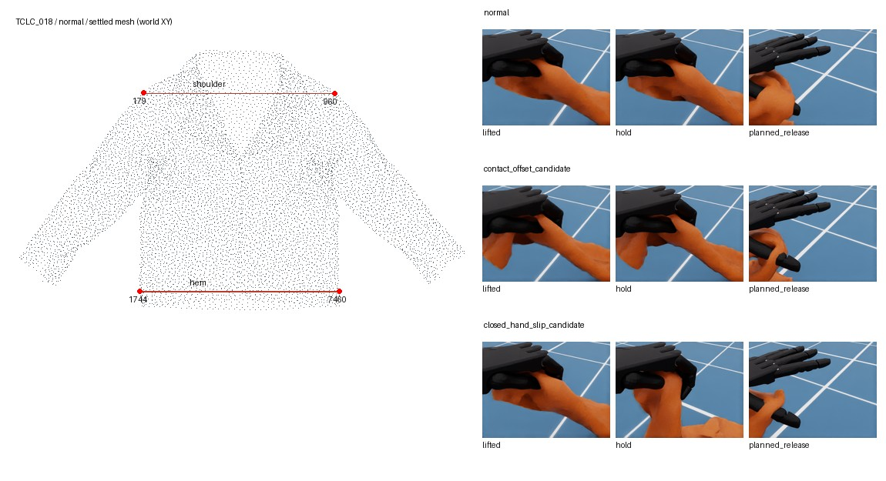

# TCLC_018 指尖近景与 DR02 标签审核

审核范围为 [#22](https://github.com/MXH814/self-correcting-robotic-clothes-folding-system/pull/22) 的三条独立试次。读取三个原始 ZIP，核对文件长度及 SHA-256，运行轨迹核验器，再按物理样本复算双指近邻、固定顶点与指尖局部位移。normal、offset、slip 分别核得 136/134/138 个 RGB 帧和 157/151/140 条有关联反馈观测的派发。所有时间均为仿真秒。原包提案和空的原始标签保留，本文登记本次裁决。[原始包清单](../research/zhangmingbo/garment-dr02-20261108/packages.json) · [提交的提案和时间锚点](../research/zhangmingbo/garment-dr02-20261108/label-review.json)

| 审核项 | 裁决 | 可用范围 |
| --- | --- | --- |
| W0 | **采用作本资产开发参考，正式肩线定位需补证** | 两截面均值符合项目的计算方式；截面位置的解剖定义仍需冻结。 |
| 预期抓取位置 | **采用正常夹持补丁作本批材料位置对照** | 固定资产、阶段、夹持策略和近邻定义下比较。脚本目标、实测对照中心分别记录。 |
| OFFSET，a3252cfe-b082-47ba-b056-ed1b61bcfdb4 | **需补证据** | 可登记为相对正常对照的稳定材料抓区偏移；正式 DR02 留空。 |
| SLIP，c7420d3d-5a48-4f23-9cda-7df8af2e627a | **采用，限本次闭手扰动后 hold 窗的离线部分滑移标签** | 有近景、同一组材料在两个手指局部坐标的持续漂移、其他布料持续处于双指近邻带三方面依据。首个失败时刻另审，暂缓纳入正式 AI01 计分。 |

### 肩部和下摆的截面如何选

在 normal 参考网格（67be478a-8d9d-40b2-bcf2-499039fbf732）上，按世界 XY 投影，以最小 Y 向上 520 mm、40 mm 为中心，各取上下 5 mm 窄带，重新取带内 X 最小与最大顶点。肩部为 179/960，455.90 mm；下摆为 1744/7460，475.24 mm；两宽均值 465.57 mm。对应 5% 门槛 23.28 mm、4% 门槛 18.62 mm。网格图显示下截面穿过躯干下摆，上截面穿过肩部斜边，两条线均避开袖口；端点是各带的极值，未必处于同一 Y 或对应缝线。

单独把肩带中心下移/上移 10 mm，重取端点，肩宽分别为 470.87/431.40 mm；下摆同样扰动得 474.78/472.20 mm。这个范围内阈值变化不足以颠倒本批 43–47 mm 的比较，但肩部对位置敏感。张茗博可提供该资产的左右肩部标志点或肩袖接缝到顶点的映射，以便确认正式注册；更换衣物需要重新标定。

### 正常补丁能回答什么

正常对照提起窗中，在 8 个样本始终落在两指 12 mm 近邻带内的参考补丁取材质顶点 5205、4916、5122、5206、5118。其平铺中心与脚本预期补丁中心相距 55.28 mm，已大于 23.28 mm 门槛。直接拿脚本坐标评判，会使这个正常示范也越线。采用独立正常示范上的材料补丁作为**本批比较基准**，可以回答“相同抓法实际抓到的部位有没有偏离通常位置”。若要回答“有没有偏离设计要求的位置”，须先由团队明确任务允许的材料区域，使用独立正常重复试次估计自然变异并冻结容差，再评分。当前只有一次对照，不能据此事后重定义任务意图。

**OFFSET。** 候选在 lifted 的 4.817–5.167 秒稳定近邻材料为 5324、5233、5492、5393、5361、4917，与正常对照五点均不同。两组在同一平铺网格的中心相距 43.18 mm；近景可见布料被带起。43.18 mm 是两个稳定材料补丁间的一次参考平面距离，八次采样验证的是近邻成员稳定性。正式采用前需补被冻结的合格目标区/对照分布，并说明闭合后接触中心与该材料补丁之间的可接受误差。4.817 秒是提起窗起点，首个闭合后偏差可能更早。

### 闭手滑移、完全失持和计划释放

**SLIP。** 固定使用本试次 lifted 窗选出的 5205、4916、5122、5206、5188、5118 六个顶点，之后按同一编号随时间跟踪。在 5.800–6.150 秒的 8 个样本中，中心相对两指各自 lifted 中位位置的位移分别为 44.74–46.84 mm、44.71–46.79 mm。八次原六点都已离开双指近邻带，每次仍有 7–8 个其他材料顶点位于带内。翻看近景，布料仍在闭合的手指间；手部命令表中预定开手始于 7.517 秒。由此采用此窗的离线 SLIP。该解释依据是近邻和图像，未测接触力。

反查过渡段：5.183 秒原六点全在带内，5.433 秒剩 1 点，5.483 秒为 0；此期间总近邻数仍为 5–8。双指位移在 5.333 秒分别约 17.7/20.8 mm，到 5.383 秒均越线且持续到 5.583 秒以上。因此 5.800 秒适合定位后续已确认窗口；冻结首个失败起点前，应约定采用首次共同越线的采样时刻还是达到 0.2 秒持续要求的确认时刻，并按 SRS 重切片段。进入 transferred 窗后近邻数也会降为零，本裁决不外推到后续阶段或整任务。

**正常与合法释放对照。** 正常 hold 窗的最大固定材料位移为 1.92 mm。7.250 秒预定开手后，7.983–8.333 秒的 8 个样本双指近邻均为零，按该阶段登记合法释放。某一组原材料退出近邻带、整片衣物脱离与控制器预定开手是三种不同情形。判完全失持还需审查当时是否仍要求持有、其他材料与图像证据；零近邻本身不能证明求解器失去接触。

**下次审核入口。** 以上均为首袖标签审核。收到新的同次完整恢复记录后，用试次 ID 检查提前宏提案、决策前观测、实际派发/反馈、固定接续、最终质量及许可/求助/预算；不能从本次三条首袖试次补写完整恢复结局。[恢复样本契约](../research/recovery-sample-contract.md)
