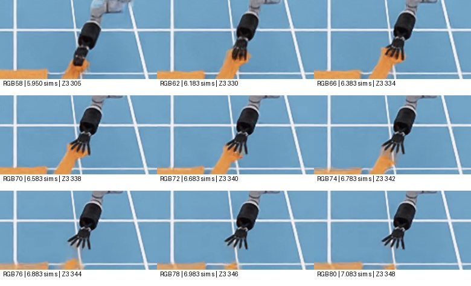

# 胡知鱼｜最新 A/B/C 案例判读与展示交接

**当前展示使用 PR29。** A 正常折完，未告警。B 由观测告警触发一次重抓，复检通过后接回折叠。C 缺检测包，系统请求停车并求助。[PPT 用结果表](evidence/pre-detection/PR29-ABC-results.png) · [Z3 离线回放、截图和原图](../research/zhangmingbo/pre-abc-evidence-20261109/Z3/index.html)

## 三例结果及可判范围

| 场景／试次 | 画面与触发依据 | 执行、复检和结局 |
| --- | --- | --- |
| A 正常抓取与提起 · `db18b274-f2e2-4cf2-9962-856a8364aad7` | 截图 01（6.083 渲染秒）袖角随夹爪提起；02 对应计划开手；03 可见桌上的折叠衣物。465 份检测报告中 52 NORMAL、413 UNKNOWN（含不适用阶段及暖窗），告警 0。没有观察到需标起点的异常。 | 恢复和求助均为 0 次，无宏后复检。26.40 仿真秒完成，区域代理 2048/2048。只说明这次正常运行的表现，无同故障关闭恢复的对照。 |
| B 提前开手 · `b5e90454-5cda-4cc0-8ec2-5606971bdf38` | 见下方可见分离区间。首次越线所用画面为 7.033 渲染秒，左袖窗口分数 1.23103、阈值 1.20661。等待前检期间另有四条越线报告；7.283 秒另有一次前检重测。 | 仅一个恢复请求；释放、退让、重抓、闭手、抬升共 61 条实际派发。9.933–10.133 秒取得 13 个宏后几何样本；新代次重新建立基线后，23 次接续持有检查通过。30.85 秒完成，区域代理 2002/2048（97.75%），求助 0。支持仿真几何意义下的持有，接触力、正式折叠质量、自主成功仍未知。 |
| C 缺包求助 · `f1054552-963e-4bde-85e8-34f0af80c8f6` | 截图 08（5.950 渲染秒）中可见手臂和衣物。缺包原因来自运行报告：5.983 仿真秒记录 `UNKNOWN / MODEL_OR_CALIBRATION_UNAVAILABLE` 和求助。仅凭画面无法识别这一原因。 | 求助后新增派发 0；无宏接受、无宏后复检。退出自动派发，未确认物理静止，未授予手动权限。没有最终区域或质量结论。本例覆盖“信息不足”分支。 |

画面判断使用[截图与源观测索引](../research/zhangmingbo/pre-abc-evidence-20261109/Z3/截图索引.json)，逐例与[事件序列](../research/zhangmingbo/pre-abc-evidence-20261109/Z3/replay-events.json)交叉核对。派发、窗口几何与点云复算引用[组长技术核验](../reviews/pr29-review.md)。没有用截图推断执行许可或质量。

## B 的可见异常区间

**按现有画面，可见分离发生在 6.683–6.883 仿真秒之间。** 从 Z3 剪辑取相邻时刻的同一图像区域，只看袖角和指尖，再与日志对照。下图保留 RGB 源帧号、渲染时间和 Z3 视频帧号。

- 第 58 帧（5.950 s）袖角在夹爪附近；62–70 帧手指逐渐张开，仍能看到布料与指尖投影重叠。开手动作本身不足以判定失持。
- 第 72 帧（6.683 s，视频帧 340）仍有重叠；第 74 帧（6.783 s，视频帧 342）袖角下落、边缘有拖影；第 76 帧（6.883 s，视频帧 344）指尖与橙色袖角间可见蓝色间隙。第 78、80 帧布料继续下落。
- 两个边界来自画面。注入事件是 5.983 s，首份报警的观测是 7.033 s。压缩视频和远景投影不足以精确定位物理接触消失的首帧，首时刻保留 UNKNOWN，也不据此计算产品检测延迟。此项是对现有影像的技术判读，未登记新的本人现场签核。

[视频帧到源帧的映射](../research/zhangmingbo/pre-abc-evidence-20261109/Z3/video-frame-map.csv)。离线打开 Z3 查看 A/B/C，暂停只影响视频播放。无法播放时可直接使用静态结果表和九帧裁图。

## 模型与材料交接

| 版本 | 可引用范围 |
| --- | --- |
| PR25 首袖旧视角 | 1,051 帧轻量输出头探索，未签发阈值。九试次回放保留作历史材料。 |
| PR27 胡的封存包 `ea15ab95…` | 完整拟合、独立校准和离线加载复验；阈值 1.18958。normal-03 是开发留出试次，十个连续越线窗口构成一段正常误报。[封存报告](matched-normal-detector.md) |
| PR29 张的实跑包 `b9df07d4…` | 左、右袖阈值分别为 1.20661 和 1.31140；normal-03 在这个版本转作校准。B 左袖宏后接续使用仿真内部材料片、指尖几何和新窗口，至计划释放结束。A/B 的实跑结论使用此版。[版本与数据用途](../research/zhangmingbo/pre-ab-revision2-20261109.md) |

新增校准试次 `94f7069b-ac87-4db6-8c6b-858e3dc3c795` 与 `045e146f-ce0e-4a74-8dae-9af37eeab272` 已列入[模型接收清单](../research/zhangmingbo/pre-abc-evidence-20261109/model/intake.json)。两份原始连续 RGB、时钟、阶段及原始清单共享后，再核实正常持有和计划释放。本次保留待审；完整 B RGB 可用于细化上述区间。新模型全部分数的独立复算由马负责。

## 最终页复核意见与个人讲稿

1. 分工文件指出的中文初稿第 11 页，A 应写为“正常抓取与提起”，B 为“观测触发一次重抓并接续”，C 为“缺包后请求停车与求助”。图注区分实际仿真记录、可点击原型和只读视频。区域代理过线只说明点云进入目标区；流程完成、人工帮助、质量和自主成功分别呈现。
2. 状态页分别显示任务已暂停、已确认静止和用户取得控制权。确认静止并显式接管后才允许调整；归还立即撤回手动权限，再取新的停车证据并校验。通过才继续，失败提示原因并允许再次接管。显式终止另列。C 的零新增派发不能表述为已经停稳或已接管。
3. **个人口播建议，目标 30 秒，待现场实测。** “请看 B 的袖角。在 6.68 到 6.88 秒之间，画面中出现了清楚的间隙。随后检测器连续五次越线，机器人只发起一次重抓。新的几何观测确认持有后，它继续折叠，最终通过区域检查。C 则因为缺少检测包而请求停车和帮助。用户仍须等设备确认静止，并明确接管后才能调整。”
4. 张整合时可只放 B 段或用静态结果表。待最终 PPTX/PDF 与对应讲稿交付，再按最终页码核措辞、图注和交接。当前未见可确认的最终稿、本人现场讲解或全员计时记录。由本人参加排练，实际出席、用时和反馈登记在[展示记录](presentation-feedback.md)。
