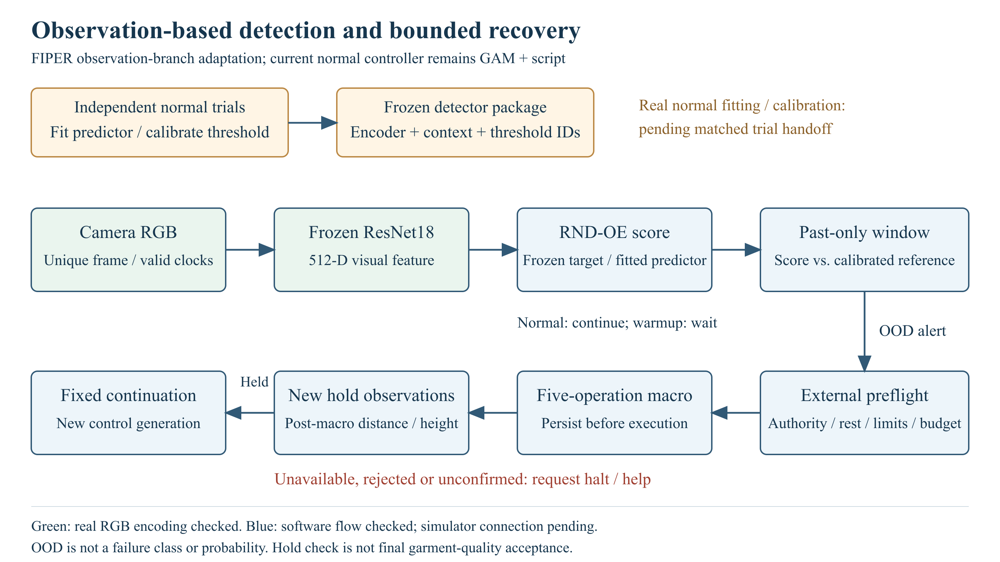
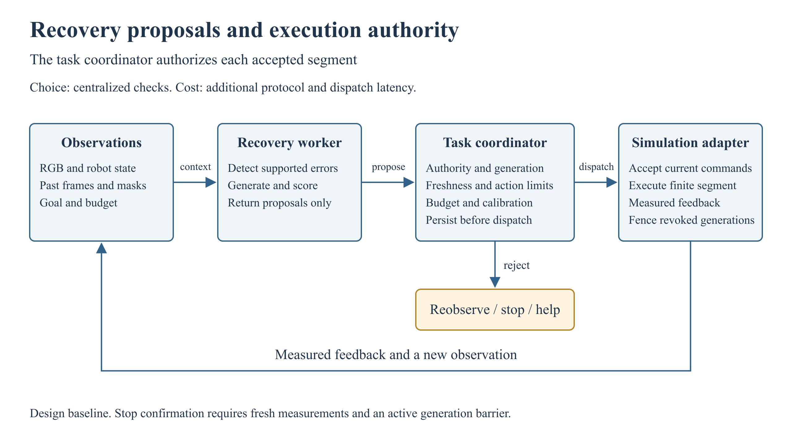

# 马祥珲：课堂展示素材与讲解

## 本次 Pre 最新主讲素材：观测检测与恢复

优先使用本节替换下方早期“主要讲权限/停止”的安排。旧素材可放备份。图与稿依据当前实际状态，不代表已经完成实际计时排练。

[可编辑 SVG](figures/ma-observation-recovery.svg) · [代码与接入命令](pre-detection-integration.md) · [ADR-MA-006](decisions/ADR-MA-006-observation-detector.md)。图中绿色表示真实图像编码已验证；蓝色表示软件流程已验证、仿真接线待完成；橙色正常拟合/独立校准待匹配数据。不是每个框都已实机运行。

### 中文主讲候选（约 60—75 秒，待实测）

我们的核心是把观测检测与实际恢复接起来。检测优先复用 NeurIPS 2025 的 FIPER 观测异常分支：固定视觉编码器提取特征，RND 用正常记录学习参考分布，通过过去窗口和独立校准阈值报警。当前控制器是 GAM 加脚本，没有生成式动作采样，所以这是观测分支适配，不能称完整 FIPER。

报警后系统先请求权限、时效、静止和动作检查，通过并记录后才执行已有五步重抓宏。动作执行结束还不够，必须用宏结束后的新观测确认持有恢复，才能接回正常折叠；否则停止并求助。我们已完成核心代码和软件验证，真实 540 帧也已跑通视觉编码。实际正常拟合、校准以及告警驱动的仿真恢复仍待联调，当前不能报告检测准确率或恢复成功率。

### English speaking draft（约 70—85 秒，待实测）

We connect observation monitoring to a bounded recovery macro. The detector adapts the observation branch of FIPER, published at NeurIPS 2025. A frozen visual encoder provides features. Random network distillation learns a normal reference, and a past-only window is compared with a threshold from separate normal trials. Our current controller is GAM plus a script, so we do not have generative action samples. This is an observation-branch adaptation, rather than a complete FIPER reproduction.

An alert requests external checks of authority, freshness, rest and motion validity. The accepted request is recorded before the five-operation regrasp macro. Execution alone does not establish recovery. New observations after the macro must confirm sustained holding before the controller resumes folding; otherwise it requests a halt and help. The software flow has regression checks, and we encoded 540 real camera frames. Real normal-data fitting, calibration and detection-triggered simulation recovery remain to be verified.

### 核心问答与事实修正

| 问题 | 当前准确回答 |
| --- | --- |
| 为什么不用完整 FIPER 或 SAFE？ | 完整 FIPER 需要真实生成式动作采样；SAFE 需要 VLA 特征及成败监督。当前复用只需观测特征的 RND-OE 分支，保留正常控制器 |
| 不需要失败数据就直接能用了？ | 仍需正常拟合、独立校准和新试次验证；不能将同一条视频拆成独立校准 |
| 检测到的是哪类故障？ | 当前输出观测 OOD，不直接判定正式 OFFSET/SLIP；类别和实际后果另核 |
| 上次完整恢复记录证明了检测吗？ | 不证明。上次是预定故障注入后执行脚本宏；新的观测触发必须另验证 |
| 目前真的做了什么？ | 核心软件/接口、作者网络复用、固定预训练编码和真实 540 帧接入；真实检测包和在线 A/B/C 待交接 |
| 叠好怎么判断？ | 区域比例只是开发代理；持有复检、最终质量、人工协助和自主成功分开，不混报 |

### 对当前十页 PPT 的技术终审意见

第 3、8 页“检测偏差/观测触发”在新证据前改为脚本恢复链；第 6 页把区域代理与产品叠衣质量分开；第 5、10 页修正接管/归还不等于终止、任务态与停止阶段混用；第 7 页区分学习适配和真实在线能力。压缩连续权限说明，补本图、文献选型、分数/事件证据、三架构和需求变化。最终修改版仍需重新终审，当前意见不是最终 Slides 通过。

---

## 以下为早期权限与研究风险素材，保留备查

2026-11-08。供张茗博整合全组Slides、完整逐页演讲稿及备份问答；本页交付的是两页展示图、取舍表、讲解及问答素材，不是已完成的整组PPT或真实排练记录。配合[展示计划](presentation-plan.md)，本人正文建议70秒＋40秒，全组实际计时不超过6分钟。

## 第5页 恢复核心设计

英文标题：Recovery proposals and execution authority。

[可编辑SVG源](figures/ma-recovery-authority.svg)。比例16:9，图中文字使用Times New Roman；可直接插入Slides，需要改字时编辑SVG或按源图重建原生形状。连续实线均在文字外，横纵连线不交叉。此为设计机制，不能在图上标成已部署或已测恢复能力。

主要信息：恢复worker给候选，协调器拥有执行权；协调器先检查当前授权、代次/时效、动作边界、预算、概率校准并持久化，再派发。adapter拒绝旧代命令并返回测量反馈；拒绝后的重观测/停止/求助按原因处理。测量静止与模型高分是不同证据。

英文讲解候选（目标约70秒，未实际计时）：

<!-- speech5:start -->
The recovery worker proposes bounded actions, while the task coordinator owns execution authority. Observations, history, the goal and remaining budget provide the context. The coordinator checks the current generation, observation freshness, action limits and calibration, then records an accepted dispatch before sending it to the adapter. We chose this separation instead of letting the model command the robot directly. It adds protocol and latency, but lets us replace the recovery method while preserving control rules. After pause or handover, the adapter must reject revoked commands even if they arrive late. A high score cannot prove that the robot has stopped. When a proposal fails the checks, the system reobserves or enters the required stop and assistance path. We have designed this mechanism. Component motion and measured stops now have evidence; the product coordinator still requires integration tests.
<!-- speech5:end -->

中文理解稿：恢复模型只提出有限动作，协调器决定能否执行。与模型直接控制相比，这会增加协议和延迟，但能统一权限、预算与旧结果处理，并允许替换算法。暂停/接管后，adapter仍须拒绝迟到旧命令；停止需要新鲜测量，不能靠预测分数证明。该图表达产品设计；组件执行和停止已有证据，完整协调器仍待联调。

## 第6页 开放问题与验证

英文标题：Open issues and verification。

[可编辑SVG源](figures/ma-open-issues.svg)。表中负责人为工作责任划分，不代表他人已经执行或签核。

英文讲解候选（目标约40秒，未实际计时）：

<!-- speech6:start -->
We now have causal pre-action RGB, named joint state and a measured component action chain. The current action enters history only after feedback, so it cannot influence its own earlier decision. Product coordinator integration remains unverified. We also measured about thirty-two millimetres of variation after repeated settling. Comparable mid-task resets, labelled failures and actual recovery branches are the next steps. If states cannot be matched, we use independent blocked trials and limit our claims. Scores remain offline rankings until calibrated evidence supports execution.
<!-- speech6:end -->

中文理解稿：动作前RGB、命名关节与真实组件执行链现已接入；动作只能在反馈结束后供后续决策作历史，不能影响自己的早期决策。完整协调器尚未验证。沉降重置差异约32mm，下一步先验证中段起点，再采带标签的失败/恢复分支；不能匹配时改用独立分块试次并限定主张。分数未校准时继续离线。

图中 Observation timing 的下一步验证现指衣物场景、连续决策与跨模块时钟。PR #13 的单次组件动作前采集已经完成，不重复要求；最新输入及历史边界见[接入结果](../research/preaction-integration-progress.md)。

本轮事实与方法选择详见[实测接入](../research/runtime-component-integration.md)及[ADR-MA-005](decisions/ADR-MA-005-measured-input-and-branch-validity.md)。图和讲稿不是完整PPT，也不代表已经实际计时。

## 关键决策备份表

| 决策 | 已选方案与理由 | 备选及代价 | 重审条件 |
| --- | --- | --- | --- |
| 执行权限 | 协调器集中授权，两阶段检查、持久化及adapter屏障；沿用SRS控制边界 | 模型直接派发路径短，但难以保证撤权/预算/审计一致；集中方案增加协议和延迟 | 真实停止/延迟或一致性验证不通过，先调整前缀/部署与实现 |
| 模型复杂度 | 可替换候选/评分接口，先简单基线和可证伪诊断；不把大模型训练设为系统启动依赖 | 直接采用VLM/世界模型/完整VLA后训练投入更大；简单方案也可能表达力不足 | H1/H2、最近邻公平比较和成本证据支持更复杂方案时升级 |
| 数据边界 | 在线来源与隐藏状态/未来标签分开，历史切段并携带mask | 直接使用仿真隐藏点/未来结果便于拟合，但会破坏部署假设和有效比较 | 只有真实来源、时钟和profile核验完成才扩大在线输入 |

依据：[ADR-001](decisions/ADR-MA-001-control-and-scoring.md)、[ADR-002](decisions/ADR-MA-002-history-and-continuation.md)、[ADR-003](decisions/ADR-MA-003-reproducible-data.md)。平台/部署选择由张茗博在前两页解释，本人不重复长篇安装背景。

## 答辩准备

| 可能的问题 | 回答要点 |
| --- | --- |
| 创新点已经确定了吗？ | 目前是待验证问题：历史是否提供独立信息、局部重抓是否代表后续完成收益。已有研究包含时序、候选选择和价值修正，不能把它们的组合直接称创新。 |
| 为什么不直接让LLM控制？ | 当前需求是明确的衣物恢复与受限执行，尚无必须用自然语言代理的证据。保留模型接口，按可部署信息、收益、延迟和成本决定方法。 |
| 已经训练好恢复模型了吗？ | 已有离线工具及人工fixture软件测试；真实正常数据编码已运行。新增真实组件编码和停止复算已完成；没有恢复候选标签，尚未完成恢复训练或有效H1/H2实验。 |
| 153帧是不是153次试验？ | 不是。它们来自两条正常示范，且作者记录是同一衣物配置；不能逐帧随机划分或当独立恢复试验。没有由此得到泛化/成功率结论。 |
| 固定RGB编码器有什么作用？ | 用8×8空间均值验证真实图像、历史和血缘的工程接入；零学习参数，不等于语义编码器、接触估计或方法创新。 |
| 人工帮助过后还能恢复吗？ | 合法返回后可按当前条件评估“后续无需进一步帮助”的成功延续；整试次仍保留人工历史，不能重新计为全程自主成功。后返回校准证据目前缺失。 |
| 暂停前的命令晚到怎么办？ | 协调器撤权，adapter安装单调代次屏障并清理队列；接纳和执行端均拒绝旧代。command ID去重本身不够。 |
| 老师现在需要看到完整运行吗？ | 本次展示设计进展、理由、三架构、变化和问题。完整原型及这些设计的实测按Part III验证计划继续，不能用动画冒充已实现。 |

评分、旧代计数和屏障的精确定义见[契约澄清](contract-clarifications.md)。现场说明自己掌握的依据，未掌握部分如实确认；本页存在不代表本人已完成口头掌握。

## 交给胡知鱼时的检查

- 这两页放在全组第5/6页，图源与讲解均已提供；整组Slides与完整逐页讲稿由张茗博整合，马祥珲核实本人技术事实，不重复新增封面占时间。
- 核对全组图中Task Coordinator、Recovery Worker、Simulation Adapter的名称和权限一致，检查实际投影字大小。
- 正文建议只讲两页英文稿；取舍表、精确定义、真实帧预览和论文依据放备份。
- 三人完整排练后根据实际时间删重，不把候选稿字数当排练通过；确认全员出席与11月9日13:30前Canvas上传。
