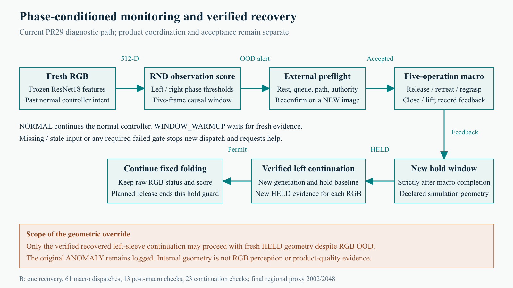
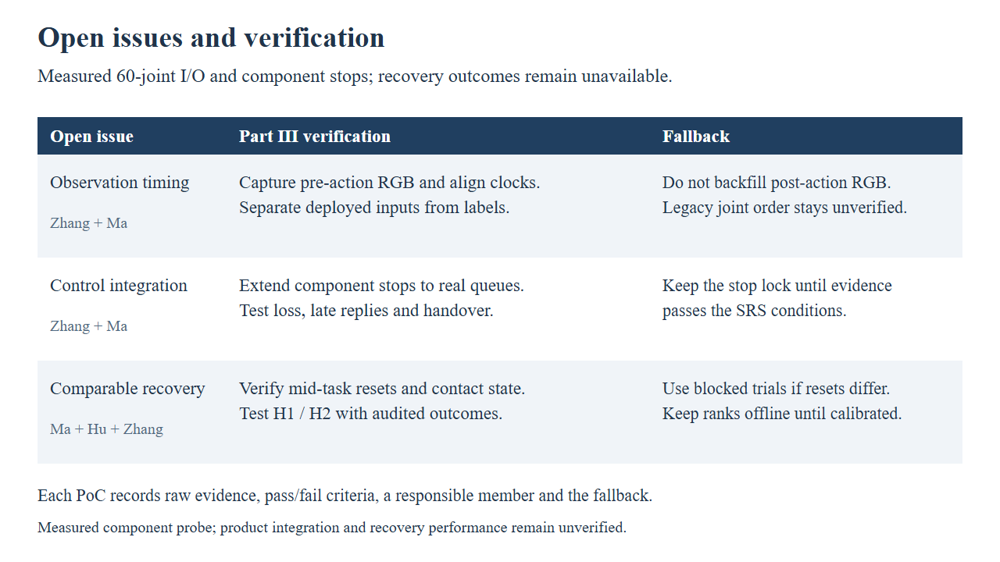

# 马祥珲：课堂展示素材与讲解

## 当前主讲素材 2026年11月9日

依据PR29审阅及本轮计时复算。下方早期材料保留作历史备份，不能把其中“尚无模型/尚无告警驱动记录”的旧描述作为当前口播。

[可编辑SVG](figures/ma-current-observation-recovery.svg) · [当前运行合同与序列](pre-current-runtime-contract.md) · [ADR-MA-007](decisions/ADR-MA-007-phase-conditioned-detection-and-verified-continuation.md) · [计时原始摘要](../research/evidence/ma-pr29-runtime-measurements-20261109.json)

图中每条箭头对应单一流向，标签放在连线外。当前主路径有实际开发记录；这不表示图中的产品授权、完整协调器或最终质量已经验收。几何接续的特权信息来源与原始RND告警保留规则单独写明。

### 中文核心讲解候选 约75秒

检测采用FIPER的观测分支适配：固定ResNet18输出512维特征，RND产生偏离分数，再用过去五帧和阶段阈值判断。左右袖正常画面不同，所以当前版本分别校准；原normal-03已经转作校准，不再称当前版本的独立留出。分数也不是失败概率。

告警后先阻断正常派发，实际测静止、同步队列与名义宏路径，再取得新的图像确认异常，记录接受后才执行释放、退让、重抓、闭手、抬升。B已有61条实际宏指令，宏后13次新测量确认持有，再以新代次进行23次接续检查。接续依赖明确声明的仿真材料片和指尖几何，原始视觉分数始终保留。

### 中文证据与局限候选 约35秒

A正常运行无告警，B由RGB告警触发恢复并完成接续，C缺检测包时求助且没有后续新派发。检测调用内处理中位约32毫秒、最大约63毫秒，不是完整系统时延。B最终区域2002/2048达标，只是开发代理。新包A/B全部958次记录调用已从原始RGB独立复算，判定一致。统计效果、正式叠衣质量和产品停车分别待验收。

上面75秒与35秒为早期独立候选稿。当前精简课堂版由马讲第6—9页165秒；胡第1—3页78秒，张第4—5页75秒，共318秒加42秒余量。第8页直接播放28.95秒B片段，含在该页50秒内，实际新版练讲与全组计时另记。

### English speaking candidate

Our detector adapts FIPER's observation branch. A fixed ResNet18 provides features, and RND deviations are aggregated over five past frames. Left and right sleeve phases use separate thresholds based on past normal controller intent. A previously viewed development trial is now calibration data, so we do not present it as an unseen test for this version. The score is not a failure probability.

An alert blocks normal dispatch. The diagnostic measures rest, synchronous queue state and the nominal macro path, then reconfirms the alert using a new image. Acceptance is recorded before five macro operations. The B record contains sixty-one macro dispatches, thirteen post-macro measurements and twenty-three continuation checks in a new generation. This restricted continuation uses declared simulation geometry while preserving the original RGB reports.

A completes normally without an alarm; B completes after alarm-triggered recovery; C requests help when detector inputs are missing. Recorded detector-call processing has a median of about32milliseconds and a maximum of63milliseconds. These are not full system latencies. The final regional proxy does not establish folding quality, statistical detection performance or product stop acceptance. The shared checkpoint and complete RGB now reproduce all 958 recorded calls, including one preflight refresh; decision fields remain identical.

### 最新问答

| 问题 | 准确回答 |
| --- | --- |
| 现在是否仍只有预设恢复？ | #24是历史预设恢复；#29的B已有RGB异常报告、前检刷新、宏执行和接续的实际开发记录。二者不混用 |
| 是胡的PR27模型直接完成的吗？ | 不是。PR27封存包独立复现完成；PR29采用张的新分阶段包，版本和数据用途分别记录 |
| 为什么恢复后还看几何？ | 恢复状态可能偏离原正常视觉分布。限定接续需要新鲜HELD证据，允许保留RGB ANOMALY继续；因此不是纯视觉全程能力 |
| 开始报警到动作隔了3秒，图像是否已经过期？ | 初报到宏开始约3.109墙钟秒；等待前检后有新帧重确认，刷新图像距宏开始约0.062秒。没有延长旧报告时效 |
| 32毫秒说明实时产品通过了吗？ | 只是已加载检测调用内处理的记录中位数；不含未测传输、队列、UI、相机曝光或产品停车 |
| 检测延迟是多少？ | PR30/32给出6.683–6.883秒的画面分离区间；这不是精确物理起点，仍不把注入时刻当真值计算正式检测延迟 |
| B是不是97.75%的恢复成功率？ | 不是。2002/2048是该试次最终点云区域比例，试次恢复成功率/最终质量需要各自标准和更多证据 |
| A/B证明恢复提高成功率吗？ | A是正常案例，B是故障恢复案例，不是同故障有/无恢复的公平消融 |
| 新模型全部独立复算完成了吗？ | PR27封存包已完成；PR31提供当前包和完整RGB后，A 465次、B 493次记录调用全部重算且判定一致 |

### 最终展示技术核对

- 用新A/B/C实跑替换“待实测”“尚无告警驱动恢复”的旧占位；A统一为正常抓取与提起。
- 明确展示当前包左右袖阈值和几何接续策略；旧PR27曲线若保留须标历史版本。
- 显示五步宏、宏后复检与接续证据；不要只展示最终True或未标来源的动画。
- 区域代理、局部持有、正式质量和自主成功分开。
- 用户接管/归还与终止规则继续按SRS；回放暂停不控制真实仿真。
- 视频若播放全片50.7秒，应相应缩短口播；不能直接加在330秒讲话之外。
- 课堂反馈、出席和上传回执须实际发生后登记，不由脚本或此候选稿代签。

---

## 以下为早期权限与研究风险素材，保留备查

2026-11-08。供张茗博整合全组Slides、完整逐页演讲稿及备份问答；本页交付的是两页展示图、取舍表、讲解及问答素材，不是已完成的整组PPT或真实排练记录。配合[展示计划](presentation-plan.md)，本人正文建议70秒＋40秒，全组实际计时不超过6分钟。

## 第5页 恢复核心设计

英文标题：Recovery proposals and execution authority。

[可编辑SVG源](figures/ma-recovery-authority.svg)。比例16:9，图中文字使用Times New Roman；可直接插入Slides，需要改字时编辑SVG或按源图重建原生形状。连续实线均在文字外，横纵连线不交叉。此为设计机制，不能在图上标成已部署或已测恢复能力。

主要信息：恢复worker给候选，协调器拥有执行权；协调器先检查当前授权、代次/时效、动作边界、预算、概率校准并持久化，再派发。adapter拒绝旧代命令并返回测量反馈；拒绝后的重观测/停止/求助按原因处理。测量静止与模型高分是不同证据。

英文讲解候选（目标约70秒，未实际计时）：

<!-- speech5:start -->
The recovery worker proposes bounded actions, while the task coordinator owns execution authority. Observations, history, the goal and remaining budget provide the context. The coordinator checks the current generation, observation freshness, action limits and calibration, then records an accepted dispatch before sending it to the adapter. We chose this separation instead of letting the model command the robot directly. It adds protocol and latency, but lets us replace the recovery method while preserving control rules. After pause or handover, the adapter must reject revoked commands even if they arrive late. A high score cannot prove that the robot has stopped. When a proposal fails the checks, the system reobserves or enters the required stop and assistance path. We have designed this mechanism. Component motion and measured stops now have evidence; the product coordinator still requires integration tests.
<!-- speech5:end -->

中文理解稿：恢复模型只提出有限动作，协调器决定能否执行。与模型直接控制相比，这会增加协议和延迟，但能统一权限、预算与旧结果处理，并允许替换算法。暂停/接管后，adapter仍须拒绝迟到旧命令；停止需要新鲜测量，不能靠预测分数证明。该图表达产品设计；组件执行和停止已有证据，完整协调器仍待联调。

## 第6页 开放问题与验证

英文标题：Open issues and verification。

[可编辑SVG源](figures/ma-open-issues.svg)。表中负责人为工作责任划分，不代表他人已经执行或签核。

英文讲解候选（目标约40秒，未实际计时）：

<!-- speech6:start -->
We now have causal pre-action RGB, named joint state and a measured component action chain. The current action enters history only after feedback, so it cannot influence its own earlier decision. Product coordinator integration remains unverified. We also measured about thirty-two millimetres of variation after repeated settling. Comparable mid-task resets, labelled failures and actual recovery branches are the next steps. If states cannot be matched, we use independent blocked trials and limit our claims. Scores remain offline rankings until calibrated evidence supports execution.
<!-- speech6:end -->

中文理解稿：动作前RGB、命名关节与真实组件执行链现已接入；动作只能在反馈结束后供后续决策作历史，不能影响自己的早期决策。完整协调器尚未验证。沉降重置差异约32mm，下一步先验证中段起点，再采带标签的失败/恢复分支；不能匹配时改用独立分块试次并限定主张。分数未校准时继续离线。

图中 Observation timing 的下一步验证现指衣物场景、连续决策与跨模块时钟。PR #13 的单次组件动作前采集已经完成，不重复要求；最新输入及历史边界见[接入结果](../research/preaction-integration-progress.md)。

本轮事实与方法选择详见[实测接入](../research/runtime-component-integration.md)及[ADR-MA-005](decisions/ADR-MA-005-measured-input-and-branch-validity.md)。图和讲稿不是完整PPT，也不代表已经实际计时。

## 关键决策备份表

| 决策 | 已选方案与理由 | 备选及代价 | 重审条件 |
| --- | --- | --- | --- |
| 执行权限 | 协调器集中授权，两阶段检查、持久化及adapter屏障；沿用SRS控制边界 | 模型直接派发路径短，但难以保证撤权/预算/审计一致；集中方案增加协议和延迟 | 真实停止/延迟或一致性验证不通过，先调整前缀/部署与实现 |
| 模型复杂度 | 可替换候选/评分接口，先简单基线和可证伪诊断；不把大模型训练设为系统启动依赖 | 直接采用VLM/世界模型/完整VLA后训练投入更大；简单方案也可能表达力不足 | H1/H2、最近邻公平比较和成本证据支持更复杂方案时升级 |
| 数据边界 | 在线来源与隐藏状态/未来标签分开，历史切段并携带mask | 直接使用仿真隐藏点/未来结果便于拟合，但会破坏部署假设和有效比较 | 只有真实来源、时钟和profile核验完成才扩大在线输入 |

依据：[ADR-001](decisions/ADR-MA-001-control-and-scoring.md)、[ADR-002](decisions/ADR-MA-002-history-and-continuation.md)、[ADR-003](decisions/ADR-MA-003-reproducible-data.md)。平台/部署选择由张茗博在前两页解释，本人不重复长篇安装背景。

## 答辩准备

| 可能的问题 | 回答要点 |
| --- | --- |
| 创新点已经确定了吗？ | 目前是待验证问题：历史是否提供独立信息、局部重抓是否代表后续完成收益。已有研究包含时序、候选选择和价值修正，不能把它们的组合直接称创新。 |
| 为什么不直接让LLM控制？ | 当前需求是明确的衣物恢复与受限执行，尚无必须用自然语言代理的证据。保留模型接口，按可部署信息、收益、延迟和成本决定方法。 |
| 已经训练好恢复模型了吗？ | 已有离线工具及人工fixture软件测试；真实正常数据编码已运行。新增真实组件编码和停止复算已完成；没有恢复候选标签，尚未完成恢复训练或有效H1/H2实验。 |
| 153帧是不是153次试验？ | 不是。它们来自两条正常示范，且作者记录是同一衣物配置；不能逐帧随机划分或当独立恢复试验。没有由此得到泛化/成功率结论。 |
| 固定RGB编码器有什么作用？ | 用8×8空间均值验证真实图像、历史和血缘的工程接入；零学习参数，不等于语义编码器、接触估计或方法创新。 |
| 人工帮助过后还能恢复吗？ | 合法返回后可按当前条件评估“后续无需进一步帮助”的成功延续；整试次仍保留人工历史，不能重新计为全程自主成功。后返回校准证据目前缺失。 |
| 暂停前的命令晚到怎么办？ | 协调器撤权，adapter安装单调代次屏障并清理队列；接纳和执行端均拒绝旧代。command ID去重本身不够。 |
| 老师现在需要看到完整运行吗？ | 本次展示设计进展、理由、三架构、变化和问题。完整原型及这些设计的实测按Part III验证计划继续，不能用动画冒充已实现。 |

评分、旧代计数和屏障的精确定义见[契约澄清](contract-clarifications.md)。现场说明自己掌握的依据，未掌握部分如实确认；本页存在不代表本人已完成口头掌握。

## 交给胡知鱼时的检查

- 这两页放在全组第5/6页，图源与讲解均已提供；整组Slides与完整逐页讲稿由张茗博整合，马祥珲核实本人技术事实，不重复新增封面占时间。
- 核对全组图中Task Coordinator、Recovery Worker、Simulation Adapter的名称和权限一致，检查实际投影字大小。
- 正文建议只讲两页英文稿；取舍表、精确定义、真实帧预览和论文依据放备份。
- 三人完整排练后根据实际时间删重，不把候选稿字数当排练通过；确认全员出席与11月9日13:30前Canvas上传。
