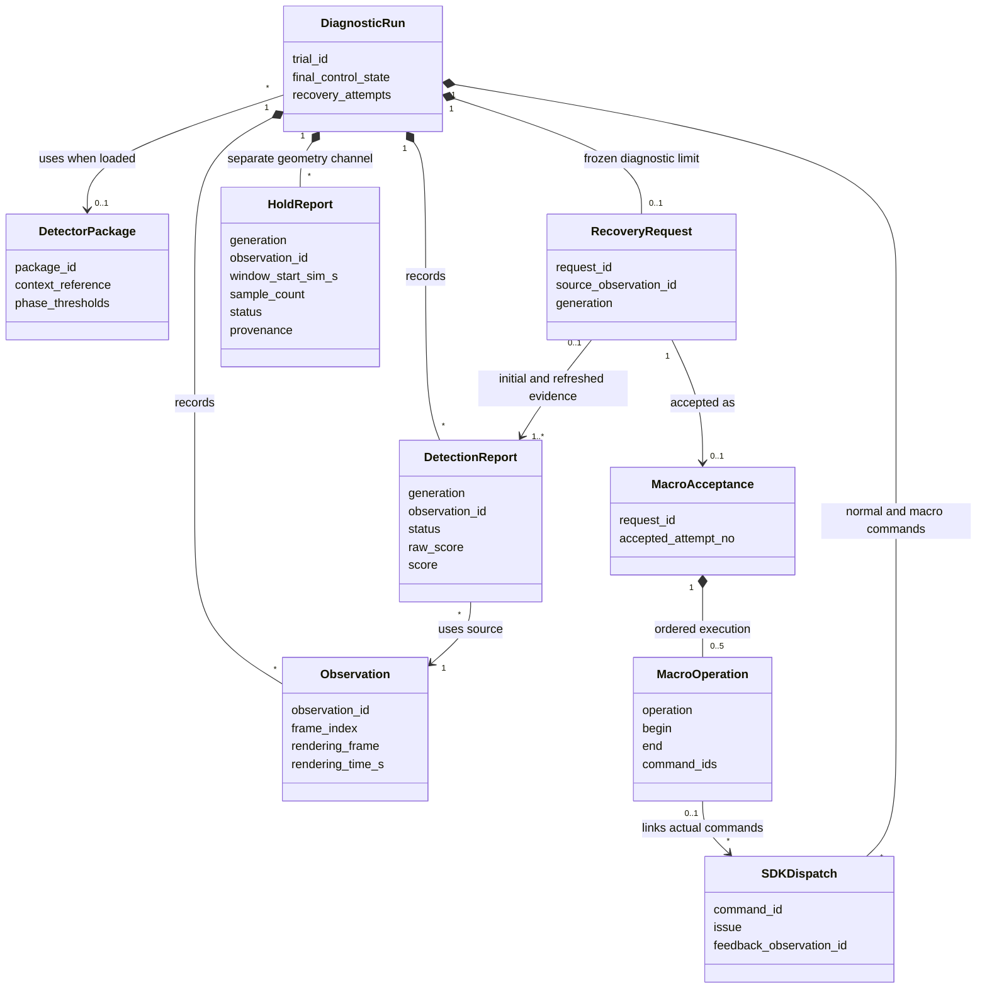
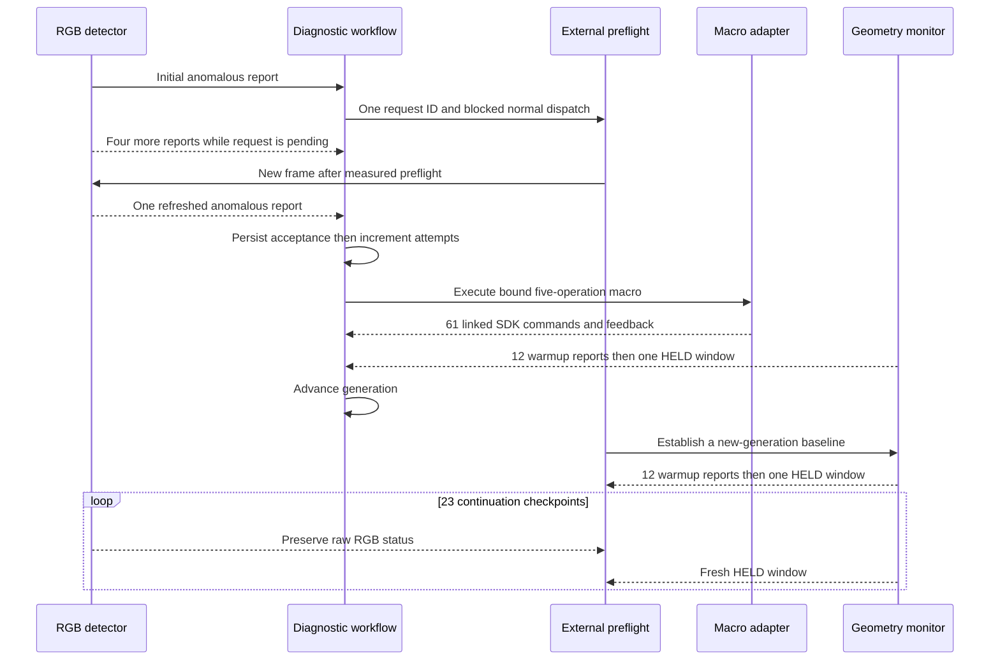

# Current diagnostic model and product mapping

This editable view describes the PR29 A/B/C diagnostic reviewed through PR32. It supplements the [target product models](zhang-system-models.md). The classes are conceptual views of existing records, not new Python classes or a changed wire schema.

## Objects and relationships



A needs no recovery request. C cannot load the detector package. The one-request limit applies to this frozen diagnostic; product attempts retain their SRS limit. A macro can fail before all five operations finish. Its operation records link actual command IDs, so unexecuted planned actions are not counted as executed.

## Canonical records

| Object | Source | Identity and interpretation |
| --- | --- | --- |
| DiagnosticRun | `full-fold-recovery.json`, `observation-trace.json` | Shared `trial_id`; a directory UUID is not another trial |
| DetectorPackage | `model/manifest.json`, run configuration | Package, checkpoint and context binding; C explicitly lacks the loaded package |
| Observation | Trace `observations` | Read ID, rendering frame/time and RGB `frame_index` |
| DetectionReport | `OFFICIAL_DETECTION` plus the preflight refresh | No report UUID exists; retain stream/sequence and observation/generation references |
| RecoveryRequest | Workflow `REQUEST_RECOVERY_PREFLIGHT` | One request ID; subsequent pending alerts do not create another request |
| MacroAcceptance | Workflow `MACRO_ACCEPTED` | Explicit `accepted_attempt_no` allocates the attempt |
| MacroOperation | Run `macro_execution` | Ordered name, begin/end clocks and actual `command_ids` |
| SDKDispatch | Trace `actions` | Command ID, issue clock and feedback observation; normal commands have no macro parent |
| HoldReport | `RECOVERY_CHECK`, `CONTINUATION_BASELINE`, `CONTINUATION_HOLD_CHECK` | Separate stage/generation and privileged provenance; not an RGB label |

`MACRO_ACCEPTED` is persisted before the counter increments. B therefore has `attempts=0` and `accepted_attempt_no=1` in that event, followed by a final run counter of 1. Reading only the old snapshot would incorrectly report zero accepted recoveries.

## Actual B interaction



The refresh report appears in both workflow `PREFLIGHT_DETECTION_REFRESHED` and main-stream `PREFLIGHT_REDETECTION`. These are two log copies of one inference call. The independent replay counts B as 492 main calls plus one refresh. Five main anomaly reports likewise correspond to one request and one macro attempt.

| Layer | A | B | C |
| --- | ---: | ---: | ---: |
| Main RGB reports | 465 | 492 | 1 |
| Additional preflight inference calls | 0 | 1 | 0 |
| Recovery requests | 0 | 1 | 0 |
| Accepted macro attempts | 0 | 1 | 0 |
| Recorded macro operations | 0 | 5 | 0 |
| SDK commands linked to macro | 0 | 61 | 0 |
| All SDK dispatches, including normal control | 774 | 842 | 86 |
| Post-macro geometry reports | 0 | 13 | 0 |
| New-generation baseline reports | 0 | 13 | 0 |
| Continuation hold checkpoints | 0 | 23 | 0 |

Each 13-report warmup sequence contains twelve UNKNOWN/WINDOW_WARMUP reports and one final HELD report. It is not thirteen independently passed checks or thirteen attempts. The 23 continuation windows overlap and do not establish 23 independent successes.

## Product mapping and remaining boundaries

| Target product concept | Current diagnostic counterpart | Remaining boundary |
| --- | --- | --- |
| FoldingTask and accepted UI request | A/B/C run identity | Complete UI-to-product task lifecycle is not demonstrated |
| OFFSET/SLIP deviation classification | RND NORMAL/ANOMALY/UNKNOWN | Visual novelty is not a calibrated failure class or probability |
| Calibrated RecoveryDecision | Fixed macro proposal and measured preflight | Does not implement the product probability threshold |
| Accepted DispatchIntent | One macro acceptance | Its 61 SDK commands are lower-level records, not 61 product attempts |
| Control generation | Increment after verified hold | Does not establish product transport, reconnect, queue or manual-return guarantees |
| StopEvidence and manual authority | Synchronous preflight; C blocks new dispatch | Zero new dispatch does not establish physical rest or manual permission |
| Quality and autonomous evaluation | Regional point-cloud proxy | Does not establish SRS landmark quality or trial-level autonomous success |

The existing product relation from a recovery decision to at most one accepted bounded intent remains valid. It must not be reinterpreted as a single SDK instruction. This mapping leaves product acceptance criteria unchanged.

## Verification

The [machine summary](../../research/evidence/ma-pre-event-layers-20261109.json) checks original portable hashes, request/acceptance identities, command membership, unique command IDs, refresh-copy equality and attempt allocation. It does not execute the robot or independently label failures.

```powershell
python tools/analysis/summarize_pre_event_layers.py docs/research/zhangmingbo/pre-abc-evidence-20261109 --output <new-summary.json>
```

Sources: [workflow](../../../research_tools/detection_recovery.py), [adapter](../../../tools/simulation/official_pre_adapter.py), [operation records](../../../tools/simulation/fold_recovery_chain.py), [A/B orchestration](../../../tools/simulation/official_ab_evidence.py). Freshness, geometry and continuation conditions remain in the [runtime contract](../pre-current-runtime-contract.md) and [ADR-MA-007](../decisions/ADR-MA-007-phase-conditioned-detection-and-verified-continuation.md).
