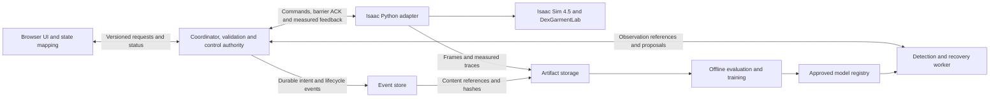
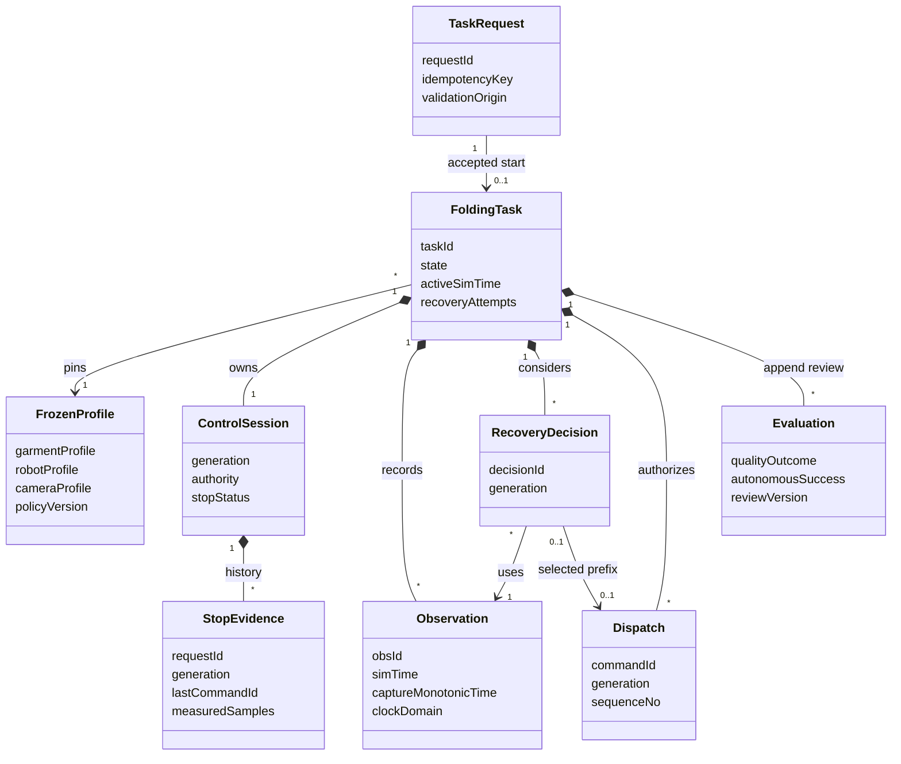
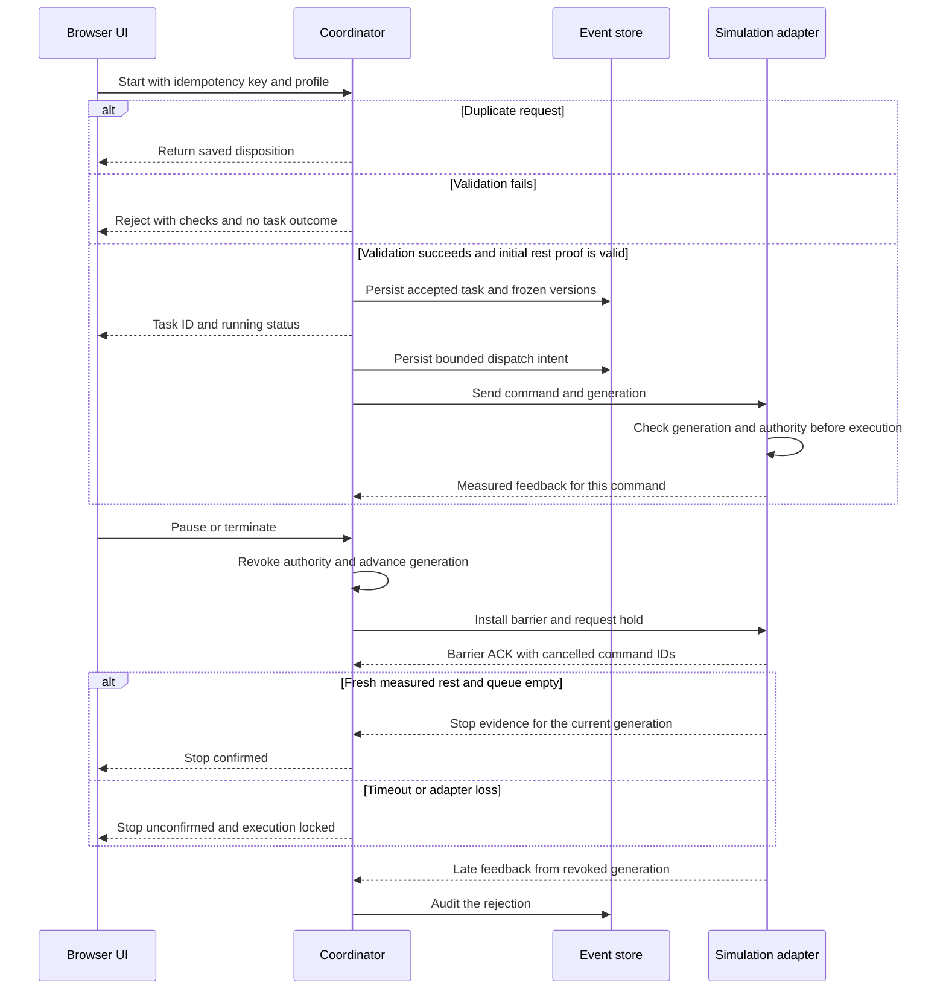
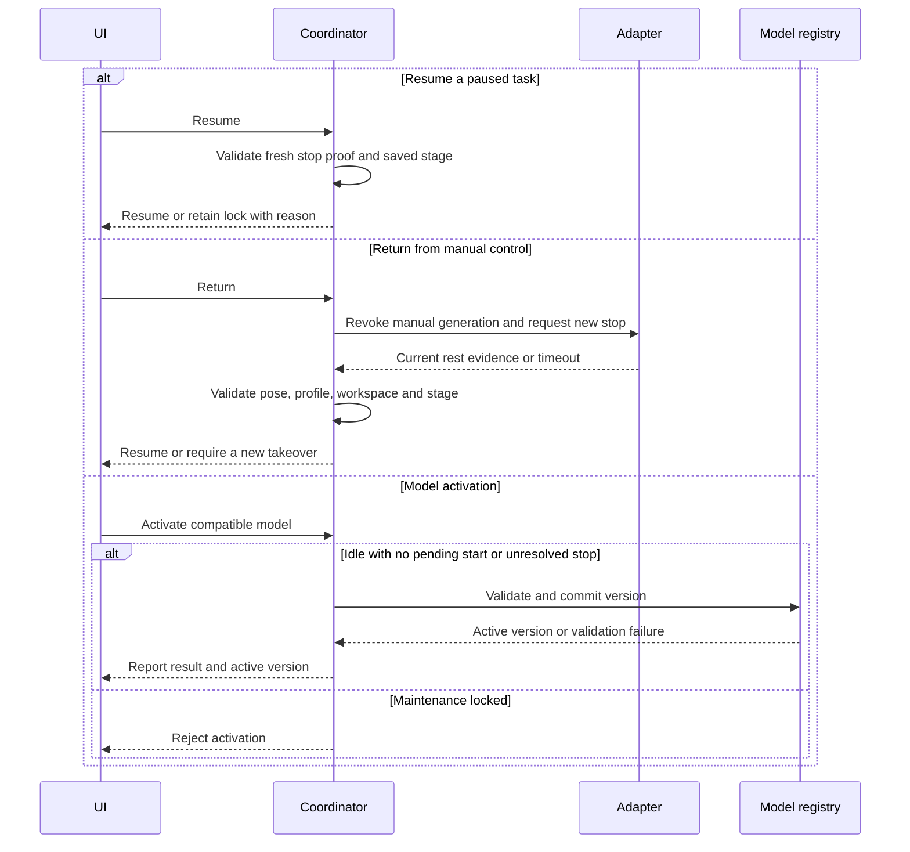

# Editable system design models

These models describe the proposed product design for Assignment 2. The local simulation evidence covers the Fold Tops baseline and component probes. The UI, coordinator and adapter together still require integration. Use the English SRS for acceptance thresholds. [Control contract](../interfaces.md) · [UI contract](../ui-contract.md) · [Measured evidence](../../research/zhangmingbo/fold-experiments-20261108.md)

## Technology architecture

The coordinator owns authority and the durable dispatch record. The adapter enforces the current generation at admission and immediately before execution. Isaac's runtime remains isolated from the inference environment. The storage engine and cross-process transport are open decisions. The proposed resource check compares process RSS, GPU use, queue age and measured stop latency under local contention. [Logical and deployment views](../architecture-presentation-draft.md)

## Domain and ownership

One accepted task pins its versions. A new control generation invalidates old authority and old rest proofs while preserving accepted dispatch accounting. A normal segment can have no recovery decision. A stop proof refers to the last command of its task and generation. An offline evaluation can append results without rewriting the terminal outcome. [Record definitions](../data-design.md)

## System API surface

| Call boundary | Required identity or payload | Observable result |
| --- | --- | --- |
| UI → Coordinator, Start | Idempotency key, selected profile, preparation checks | Rejected with reason or accepted task ID and pinned profile |
| UI → Coordinator, Pause, Resume, Terminate, Takeover, Return | Task ID, request ID, current expected generation | Current task state, stop status and permitted operations |
| Gateway → Coordinator, Observe | Observation ID, profile, frame provenance, simulation time and mapped monotonic capture time | Valid observation reference or missing/stale reason |
| Coordinator → Adapter, Dispatch | Task and command IDs, generation, sequence, bounded targets with units and frame | Receipt or rejection. Execution feedback carries measured state and the original identity |
| Coordinator ↔ Adapter, Halt and rest | Stop request ID, task, generation and last command. Reply includes samples, queue depth and active segment state | Barrier ACK separately from measured rest or timeout |
| UI → Record store through application API | Task or replay reference and cursor | Ordered events and evaluation references with read-only access |

Commands are checked both on admission and just before execution. Unsupported profile or stale observation rejects a dispatch. Invalid rest evidence preserves the execution lock. Details and existing reason codes remain in the adopted contracts. [Message fields](../interfaces.md) · [UI reasons](../ui-contract.md)

## Start, dispatch and fault ordering

The task outcome and execution lock are separate. Termination may become terminal while the stop remains unresolved. A transport reconnection leaves authority revoked until a current proof and the relevant validation permit a subsequent authorized action. [Stop contract](../contract-clarifications.md)

## Resume, manual return and model activation

Recovery proposal and rejection paths are specified in the recovery model. A validated normal stage and a saved recovery state follow distinct continuation rules. [Recovery sequence](../recovery-design.md)
