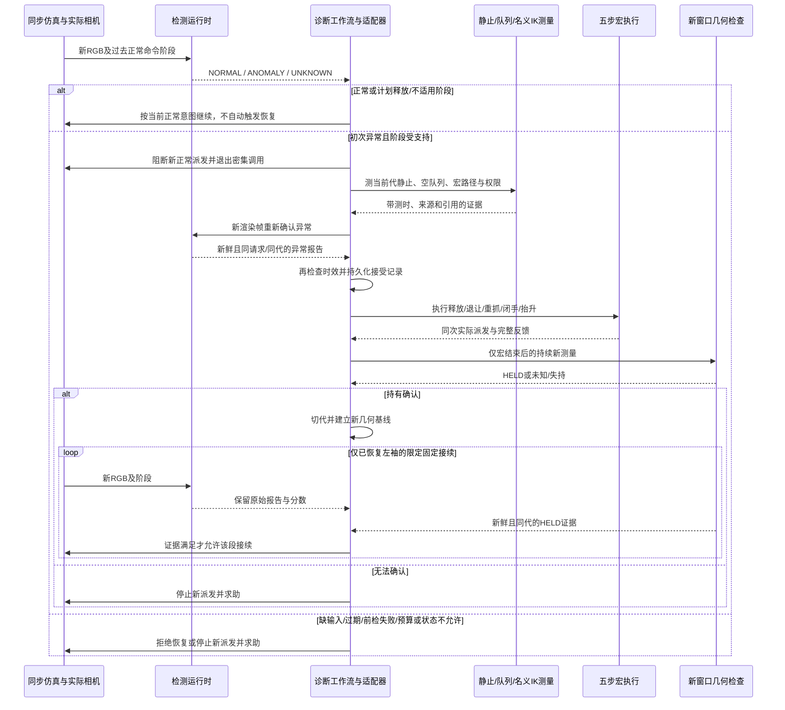

# 当前 Pre 检测与恢复运行合同

更新：2026-11-09。本文描述 PR29 已运行的开发诊断路径；SRS 和 `recovery-contract/0.1-draft` 继续作为目标产品合同。两者范围不同，不以此诊断路径替代产品概率、停车、预算或质量验收。

## 版本和输入

| 项目 | 当前诊断路径 | 验证范围 |
| --- | --- | --- |
| 视觉特征 | 官方预训练 ResNet18，固定预处理，512维 | 共享完整RGB后已重算A 465次、B 493次（含1次前检刷新） |
| 观测模型 | 作者 RND-OE 网络的观测适配，128维输出，完整预测网络拟合 | 不含生成式动作熵或原文统计保证 |
| 现场包 | `b9df07d4...`，上下文 `pre-observation-context/1#sha256=1d1647b37737a31c865659e5fab23eaa2ecde0739f950d07bd4b33c737f26a75` | PR31完整checkpoint已共享；包/张量绑定与逐次判定复算通过 |
| 阶段/阈值 | 左袖1.2066080809；右袖1.3113971710 | 阶段来自过去正常命令；释放/其他阶段不判故障 |
| 历史 | 当前帧与此前四帧，共五帧；阶段、代次、任务变化及断档重置 | 不读取注入标志、未来结果或仿真材料点作为RND输入 |
| 恢复后测量 | 固定材料片与实际指尖的世界坐标，明确 `privileged_sim_material_patch` | 用于有限持有复检与限定接续，不是摄像头感知或独立人工标签 |

## 职责和工具边界

| 组件 | 可做的事 | 不能据此声称的能力 |
| --- | --- | --- |
| `DetectionRuntime` | RGB白名单、版本/时效、编码、RND与因果窗口，输出NORMAL/ANOMALY/UNKNOWN | 不输出正式OFFSET/SLIP真值，不将分数包装成失败概率，不派发动作 |
| `DiagnosticRecoveryWorkflow` | 请求前检、刷新告警、接受/计次留痕、宏反馈、新窗口复检和切代 | 不以报告的 `motion_authorized=false` 取代外部执行许可 |
| `OfficialPreAdapter` | 绑定完整宏文件及请求，检查有引用/测时的四项外部证据，先持久化后执行五步宏 | 不验证物理碰撞/接触力或真实设备队列，不授予人工接管权限 |
| `OfficialABEvidence` | 仿真观测接线、阻断正常派发、退出密集调用、组织实际测量和限定接续 | 不是完整产品协调器、网页实控、计费或分布式恢复实现 |
| `GeometryHoldMonitor` | 固定来源的持续距离/抬升检查 | HELD不等于SRS最终质量或整任务自主成功 |

## 关键交互和异常



前检刷新必须是新观测/新渲染时刻，不能仅换UUID、重读旧图或重写墙钟。它不新增尝试、不延长旧报告时效、不改变同次请求。宏后复检不能使用宏前窗口；新代次接续也不能直接沿用旧代证明。

限定接续中，RND ANOMALY 仍原样保存；新的仿真几何HELD可支持该段继续。RGB缺失/无效、几何UNKNOWN/LOST等条件不因“上一帧成功”而放行。计划释放不按异常脱离处理，C的缺包求助也不是遮挡识别或真实恢复失败。

## 本轮实跑可证明什么

| 场景与试次 | 已核事实 | 不能扩大为 |
| --- | --- | --- |
| A `db18b274` | 正常折叠结束，0告警/0恢复；区域2048/2048 | 同故障无恢复的消融，或总体误报率 |
| B `b5e90454` | 首报7.033334仿真秒，1次恢复、5步61条宏指令，13次宏后复检与23次接续检查，区域2002/2048 | 纯视觉全程控制、恢复成功率、正式叠衣质量或自主成功 |
| C `f1054552` | 缺包UNKNOWN并求助，后续新增派发0 | 已测物理停车、已授权人工调整或实际宏失败后的恢复能力 |

PR31已共享原始权重与完整RGB；[独立复算](../reviews/pr31-review.md)检查A 465次、B 492次主检测及1次前检刷新，身份、阈值、状态和原因全部一致。最大原始分数差2.623e-6，聚合分数差1.002e-6，小于预先设置的1e-5绝对容差；离线复算不验证在线时延。胡的PR27封存包保持独立，其normal-03误报结论不回写成本版本通过。

## 运行时计时的解释

[可重算JSON](../research/evidence/ma-pr29-runtime-measurements-20261109.json)使用已绑定指纹的原始日志：

| 量 | A | B | 含义 |
| --- | ---: | ---: | --- |
| 记录的检测报告数 | 465 | 492 | 包含范围外/预热UNKNOWN，不都属于可判窗口 |
| 检测调用内处理中位数 | 0.032秒 | 0.032秒 | 已加载运行时的编码/检测调用处理，不是完整系统时延 |
| 调用内处理P95 | 0.047秒 | 0.047秒 | 单次运行的记录分位数，不是跨场景保证 |
| 调用内处理最大值 | 0.063秒 | 0.063秒 | 不含模型加载、未测队列、UI或相机曝光链路 |

B首次报警判定到宏开始约3.109墙钟秒，前检后的新图像读取距宏开始约0.062秒。前者包含慢仿真测量等待，后者支持本次接受时采用新鲜证据。PR30新增画面技术判读：源帧72至76的可见分离区间为6.683至6.883渲染秒。它不是物理接触消失的精确起点或本人现场签核，因此仍不计算正式检测延迟，也不把注入时刻当作人工真值。

复算命令（使用新的输出文件，不运行仿真）：

```powershell
python tools/analysis/summarize_pre_runtime.py docs/research/zhangmingbo/pre-abc-evidence-20261109 --output <新的统计JSON路径>
```

## 仍待完成的验收

新包共享及A/B全部记录调用的分数复算已关闭。新增两条正常记录已通过文件、身份与完整流程机械核验，PR32又完成独立正常性技术判断，本人签核仍另记。正式故障起点与类别、泛化与统计误报、产品端到端时延、物理停车、最终质量和实际课堂反馈各自待验收，不能由单次视频或205项软件测试代替。

设计理由与备选见[ADR-MA-007](decisions/ADR-MA-007-phase-conditioned-detection-and-verified-continuation.md)。
