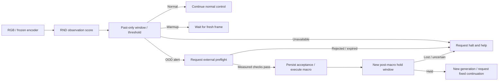

# Pre 检测与恢复：马祥珲核心交付及接入指南

2026-11-08。目标是适配文献组件并接入有限恢复流程，不是完整 FIPER 复现。当前阶段先完成 Pre，论文训练和大规模采集暂缓。

## 当前实际完成程度

| 环节 | 已有结果 | 仍需什么 |
| --- | --- | --- |
| 视觉输入 | 严格加载官方 ResNet18 权重，生成 512 维特征；PR #24 真实 540 帧已实际编码 | 新正常数据须核相机/阶段/控制一致性 |
| 观测异常模型 | 固定提交的作者 RND-OE 网络已复用；冻结目标、拟合预测器、保存/加载均可运行 | 胡用真实独立正常试次拟合、校准和验证；当前没有获验的真实检测包 |
| 在线推理 | 输入/版本检查、过去窗口、缺失和超时 UNKNOWN、去重复/换代重置已实现 | 张接真实观测并测在线时延 |
| 恢复流程 | 检测告警→前检请求→外部许可→日志→宏→新观测复检→接续/求助已实现软件状态流程 | 张接已有真实五操作宏、反馈和停止证据，实际跑 A/B/C |
| 恢复后检查 | 持续距离/抬升几何检查已实现，标明可见深度或仿真材料点来源 | 张提供连续可用的检查观测及经核对的几何配置 |
| 质量与产品 | 无新增通过结论 | 区域代理、SRS 质量、自主成功和产品控制分别验收 |

**540 帧是一次试次的观测，不是 540 个独立试验。** 当前编码保持 `UNSPECIFIED` 阶段、未分配划分、无正常标签，未用它伪造独立拟合和校准。软件测试中的正常数据声明明确是 fixture，不是胡的人工审核。

## 实际代码入口

| 文件/入口 | 功能 |
| --- | --- |
| `research_tools.detection_encoder.FrozenRGBEncoder` | CPU/GPU 冻结 RGB 编码，只有 torch、NumPy、Pillow 依赖，无 torchvision 二进制扩展 |
| `research_tools.observation_detector.fit` | 读取正常拟合/独立校准试次，拟合作者 RND 网络，输出模型包和经验阈值 |
| `research_tools.observation_detector.OnlineObservationDetector` | 给定特征输出原始分数、过去窗口均值、阈值和 NORMAL/ANOMALY/UNKNOWN |
| `research_tools.detection_runtime.DetectionRuntime` | 张可调用的 RGB→报告入口；缺模型或校准返回 UNKNOWN |
| `tools/simulation/pre_detection_bridge.py` | Isaac 启动器切到上游目录时的导入桥；映射最新观测且不复制注入 phase |
| `research_tools.detection_recovery.DiagnosticRecoveryWorkflow` | 诊断请求与恢复生命周期，不调用机器人 SDK |
| `research_tools.detection_recovery.GeometryHoldMonitor` | 阶段条件持有检查，不输出正式 DR02 或 SRS 成功标签 |
| `third_party/fiper/`、`third_party/torchvision/` | 固定来源的网络核心、许可证及适配记录 |

## 张现在要接的输入

不需要 SADP_G 权重。先固定 RGB 相机和正常控制器。每次独立试次保留完整 ID，不把故障标记、注入步数、最终结果或隐藏几何塞入 RGB 检测器。

Isaac 包装脚本会切换到上游目录，不能假设仓库根目录仍在模块搜索路径。与现有采集脚本同目录的桥可直接 `from pre_detection_bridge import create_runtime, make_input`，它只补仓库模块路径，不启动仿真或派发动作。`make_input(trace, newest_obs, controller_phase="HOLD", runtime=runtime)` 只映射最新实际观测和正常控制阶段，不复制 trace 中的注入 phase。读取图像可用 `trace.frames[newest_obs["frame_index"]]`；`captured_wall_s` 用该观测 `camera_read_begin.wall_monotonic_ns / 1e9`。

`DetectionRuntime.observe` 的 `observation` 必须恰好含下列字段，`encoder_reference` 可由成功加载的 `runtime.encoder.reference` 取得：

```python
observation = {
    "trial_id": trial_id,
    "lineage_group": trial_id,  # 若来自共同源/分支，保留共同 lineage，不能改 ID 掩盖
    "observation_id": observation_id,
    "frame_id": str(rendering_frame),
    "sim_time_s": rendering_time_s,
    "read_sim_time_s": camera_read_end_sim_s,
    "phase": "HOLD",  # 来自正常控制阶段，不能从故障注入答案产生
    "context_reference": frozen_sensor_controller_reference,
    "encoder_reference": runtime.encoder.reference,
}
report = runtime.observe(
    rgb_uint8_hwc, observation,
    generation=current_generation,
    captured_wall_s=camera_read_monotonic_s,
    now_wall_s=time.monotonic(),
)
```

模拟时间只用于窗口与观测顺序；wall monotonic 用于时效，不跨机器/域相减。上例为接口示意，不代表张已接线。缺模型时 `runtime.encoder` 也可能为空，C 分支传已记录的预期引用或记录缺失，不能访问空对象强行构造有效样本。

`context_reference` 要绑定相机配置、正常控制器和资产，不能仅写“同一环境”。源文件或传感器变化后显式核兼容性，不能静默复用旧阈值。默认只消费当前及过去观测；正常释放阶段由调用方标明，不能当作预期持有异常。

## 胡的离线命令与文件

以下命令从仓库根目录执行。首次明确下载官方编码权重；已有同哈希文件直接复用，不覆盖。

```powershell
python -m research_tools.detection_encoder fetch-weights --output checkpoints/detection/resnet18-f37072fd.pth
python -m research_tools.detection_encoder encode-trace --input <真实完整轨迹目录> --output <新特征目录> --weights checkpoints/detection/resnet18-f37072fd.pth --context-reference <已冻结传感器控制引用>
```

导出默认阶段是 `UNSPECIFIED`，不能直接用于拟合。胡依据正常控制阶段逐观测补充 `HOLD/LIFT/RELEASE/OTHER` 等真实阶段，保留修改依据并重新计算特征文件哈希。只有输入全程确为同一阶段时才可使用 `--phase HOLD`，不能把整段折叠强行标成持有。试次仍保持一个血缘组。

`partitions.json` 结构如下；占位路径/哈希必须替换，正常声明和引用必须有实际依据：

```json
{
  "fit": [{
    "features": "fit-trial/features.jsonl",
    "feature_sha256": "<该文件SHA256>",
    "source_reference": "<拟合试次原始包内容标识>",
    "normal_review": true,
    "review_reference": "<真实正常审核依据>"
  }],
  "calibration": [{
    "features": "another-trial/features.jsonl",
    "feature_sha256": "<另一文件SHA256>",
    "source_reference": "<独立校准试次原始包内容标识>",
    "normal_review": true,
    "review_reference": "<该试次正常审核依据>"
  }]
}
```

```powershell
python -m research_tools.observation_detector fit --partitions <partitions.json> --output <新模型目录> --phase HOLD --epochs 10
python -m research_tools.observation_detector score --package <模型目录> --input <新验证试次features.jsonl> --output <新分数回放.jsonl>
```

默认输出维度 128、窗口 5、断档阈值 0.25 仿真秒、经验分位数 0.95 是开发配置，不是已证准确的参数。需要调整时用 Python `fit` 的同名参数并记录版本，不在验收试次上来回调参。CLI 的回放采用虚拟 wall clock，**不能用其时间差报告真实在线推理延迟**。

文件至少需要独立的拟合和校准 trial，代码的最小可运行数量不等于统计充分；单一试次不论切多少帧都不满足独立划分。已有官方 100 条示范先核相机/字段，不能默认兼容。开发验证不参与拟合与阈值选择；软件不会自动为胡生成正常审核结论。

## 从检测到实际宏：张的连接位置

```python
flow = DiagnosticRecoveryWorkflow(
    trial_id,
    journal=JsonlJournal(new_trial_dir / "detection-events.jsonl"),
    detector_package_id=runtime.detector.meta["package_id"],
    context_reference=frozen_sensor_controller_reference,
)
request = flow.on_detection(report, now_wall_s=time.monotonic(), expected_holding=True)
# 只有 REQUEST_RECOVERY_PREFLIGHT 才进入前检；其他 kind 按定义处理。
# 外部适配器先真实检查：本代权限、静止证据、空队列、宏路径/范围合法。
accepted = flow.begin_macro(request["request_id"], permit=measured_permit)
# 只有 MACRO_ACCEPTED 才调用现有 release/retreat/regrasp/close/lift。
# 等实际动作与反馈完成后，报告五个操作及真实结束模拟时刻：
flow.finish_macro(request["request_id"], operations=completed_operations,
                  feedback_complete=True, finish_sim_s=actual_finish_sim_s)
# 用 VERIFY_RECOVERY 阶段持续采新几何观测，调用 GeometryHoldMonitor，
# 传同域 captured_wall_s/now_wall_s；再 flow.verify(check, now_wall_s=time.monotonic())。
# 只有 REQUEST_FIXED_CONTINUATION 才请求原折叠流程接续；它仍不是 SDK 命令或产品授权。
```

这是接线说明，不是可直接整段粘贴的仿真程序。`measured_permit` 含 `trial_id, generation, now_wall_s`，以及外部核实的 `authority, measured_rest, queue_empty, macro_validated` 四个布尔结论。不能为了通过检查全部手填 True；暂无测量时保留拒绝。请求 ID、实际动作反馈和日志必须同源。

缺包的 C 场景创建流程时不绑定检测包，传 `detector_package_id=None`，不要访问空的 `runtime.detector.meta`；UNKNOWN 会请求停止/求助，已知状态也不能在未绑定包时触发宏。

若对当前慢仿真而言报告在等待静止后过期，应取得新观测/新检测，再重新前检，不延长时效掩盖旧输入。完整产品的互斥、代次屏障和幂等派发仍由协调器/适配器实现；本流程只记录诊断生命周期。

几何配置 `table_z_m/min_cloth_height_m/max_hand_distance_m` 必须根据场景及可追溯材料点核对。使用 `privileged_sim_material_patch` 时明确是仿真内部信息。复检整个持续窗口必须晚于宏结束，不能重用重抓前的窗口，也不能仅凭 SDK 返回 True 宣布恢复。

## 状态和验证范围



`ANOMALY` 是观测异常告警，正式 DR02 类别仍未知。几何持有通过不代表 SRS 八点质量、自主成功或概率校准；所有报告的 `motion_authorized=false`。本次诊断宏不是绕过产品 0.60 概率门槛的产品实现。

## 交接与未完成项

- **马已提供：** 核心代码、上游组件归属、固定视觉输入、缺失/时效处理、恢复流程与复检、软件回归、ADR 和本说明。
- **胡下一步：** 正常数据用途清单、正常审核、阶段依据、独立拟合/校准、真实分数曲线、开发验证和模型/阈值包。
- **张下一步：** 实际同相机观测、阶段/上下文、恢复宏与测量许可接线、A/B/C 真实记录和整组 PPT。
- **马仍需：** 审核胡的真实检测包、根据张的运行记录修正与验证、审核最终 PPT、实际排练及本人讲解。缺独立正常记录、检测包和仿真接线时，不能宣称这些项目完成。

方法备选与重审条件见 [ADR-MA-006](decisions/ADR-MA-006-observation-detector.md)，缺 SADP_G 的具体解释见[输入交接说明](detection-input-handoff.md)。
