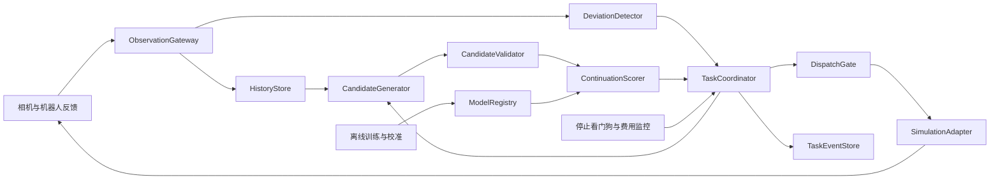
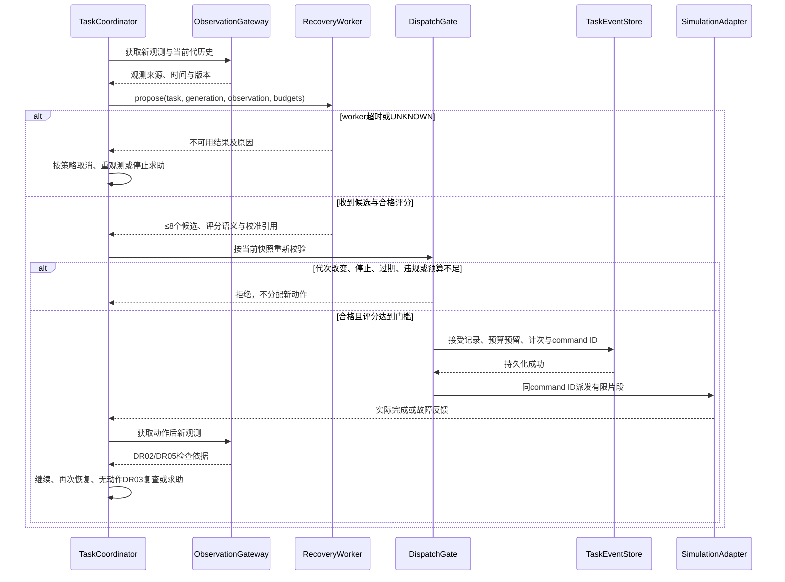
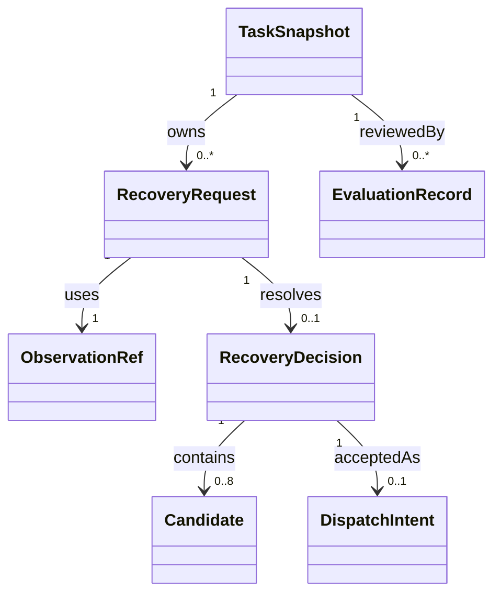

# 自主恢复模块设计

Design 实现基线，2026-11-06。马祥珲工作流，AI 辅助撰写；组长已授权独立推进，队友可审核提意见。产品约束来自英文 SRS；逻辑方案已采纳，离线门禁与诊断子集已有代码，完整物理系统/校准模型未实现。见[执行决定](../research/ma-owner-decisions.md)与[运行说明](../research/execution-guide.md)。

## 1. 目的与需求覆盖

恢复模块在抓偏/部分滑移后提出有限纠正动作，并以新观测检查结果。它向任务协调器提出建议，不直接操作机器人，也不证明停止或最终成功。

| 范围 | SRS 对应 | 设计落实 |
| --- | --- | --- |
| 偏差、历史、有限恢复 | FR03/05/06；DR02/04/05 | 阶段感知检测、在线历史、候选与排序、派发复检 |
| 暂停、终止、交接 | FR07–09；AI04 | generation 撤权、取消推理、控制器外部门禁、无旧命令复活 |
| 结果与回放 | FR10/11；AI02/03 | 运行、质量、人工、自主成功分别保存；预测不是结果 |
| 训练与激活 | FR12–15；AI07 | 清单隔离、校准/版本冻结、空闲激活、付费作业预算 |
| 维护、延迟与日志 | NFR03/05/06/07；AI05/06 | 契约版本、两次新鲜度检查、独立停止/费用监控、写入失败拒绝派发 |

SRS §5.6.3–5.6.5、§7 的阈值沿用，不重新估定。改动须经过需求变更记录。参考 [课程验收清单](../assignment-2-checklist.md)。

## 2. 系统位置与组件职责

此图为恢复组件逻辑图，不能替代张茗博负责的系统总体/部署/技术三视图。拟采用同机模块化核心，仿真与推理可独立进程；网络和持久化技术待系统架构确认。

| 组件 | 职责与输入输出 | 不应承担的职责 |
| --- | --- | --- |
| ObservationGateway | 验证来源、时戳、schema、相机/机器人 profile，提供 online 观测引用 | 把隐藏网格真值转成相机特征 |
| HistoryStore | 同任务同代内已发生观测与已执行动作，保留缺失/中断掩码 | 读未来帧或把未执行候选写进执行历史 |
| DeviationDetector | 阶段/预期持有与观测 → NORMAL/OFFSET/SLIP/UNKNOWN | 将合法释放认定滑移或决定停止已完成 |
| CandidateGenerator | 支持偏差、历史、目标/预算 → ≤8 个短动作提案，可返回空 | 派发、修改预算、决定模型激活 |
| CandidateValidator | 动作 schema、非有限值、坐标/关节/速度/工作区约束 | 用高预测分覆盖约束违规 |
| ContinuationScorer | 合法候选＋在线上下文 → 条件成功估计/拒绝及校准引用 | 将排名值伪装概率，写 COMPLETED 或控制设备 |
| TaskCoordinator/DispatchGate | 唯一授权、generation、预算预留、事件提交、接受派发及计数 | 依赖策略自报的“安全”取代设备反馈 |
| ModelRegistry | 兼容性、验证/终测证据与已批准激活版本 | 因研究脚本产生模型文件就自动启用 |

## 3. 观测、历史和检测设计

在线观测只包含声明的相机/深度派生点云、机器人反馈、目标、预算、任务阶段及过去执行历史。点云须记录生成途径和标定，不允许读取 mesh 顶点伪装成相机点云。隐藏地标和接触真值可以存在独立 offline evaluation 文件，在线进程无读取路径。

HistoryStore 按时间排序，保存实际完成/中断的动作及执行量。暂停或控制交接使 generation 失效；历史原记录用于审计，模型输入按当前代和控制模式切段，并携带 gap mask，不将人工未知动作拼成连续自主历史。跨代使用历史如未来需要，先定义可观测人工动作与掩码并评审；不能静默使用。

检测按 SRS DR02 考虑预期持有：抓偏 >0.05W0，滑移漂移 >0.04W0 或意外丢失，并满足 ≥0.2 仿真秒/≥10Hz。合法释放更新持有预期；低置信、遮挡或冲突进入 UNKNOWN 并停止/求助。真实接触难从图像推断时如实拒绝；离线真值不直接成为在线检测输入。校准置信阈值沿用 SRS 暂定 0.80。

## 4. 候选生成、效用与评分

先实现可替换规则/已有策略生成器，再基于 H1/H2 决定学习结构。动作 profile 固定通道、单位、坐标、允许姿态、速度和最长前缀；缺项阻止接受任务。候选可局部重新定位/重抓，但任何释放都必须符合阶段/持有约束，不能因“纠错”获得额外权限。

评分定义为：给定目标、当前阶段、在线历史、候选动作、剩余预算及固定接续控制器，估计从当前决策开始、无进一步求助/介入地完成并通过最终质量的概率。它与AI03整试次自主成功分别记录：已有人工介入的试次仍不能计入整试次自主成功，但不应让人工返回后的后续目标永久为零。训练/校准标签必须明确决策时间边界和后续求助/介入，不能直接复用含既往介入的整试次标记。当前工具及正常示范还不具备人工返回后监督/校准证据；见[契约澄清](contract-clarifications.md)。

DR04：最多 8 个，先排除不合法者；在其余者中按合格估计选择最高分，拟定门槛 ≥0.60。可靠性曲线和阈值只在验证集评估并 G3 冻结。未校准模型仅能输出研究排名，不能以其分数通过 DR04。规则对照如无公共可校准评分路径，须在实验协议中提出明确门禁实现/需求修订并评审，不能凭空给规则动作填 1.0。选择同分时按稳定 candidate ID 打破，不增加尝试或搜索预算。

所有候选都被拒/低于门槛则停止并请求帮助，零候选不消耗恢复次数。初期无已验证评分模型时，课程可展示设计或明确标识的测试桩；不能宣传已具自主恢复性能。

## 5. 两阶段检查与并发规则

推理入口检查观测年龄 ≤1 wall s。生成/评分后派发前再次检查当前任务、generation、authority、stop/queue、观测年龄 ≤1 wall s、模型/profile、次数和活动时间/费用。`1–2 s` 的结果即使已经算完也不得执行；`2 s` 到期取消；连续 3 次不可用决策停止/求助。

在同一个 task lock/串行事件循环中做版本比较、预算预留、尝试号/command ID 分配与接受记录。接受即消费一次恢复尝试（最多 3）；派发后中断也不退还。重复 decision/idempotency key 返回原 disposition，不分配新次数。仅重评分不计次。

先持久化 dispatch intent/预算预留/恢复计数，再以同一 command ID 向 adapter 发命令；adapter 去重。若发送失败或进程中断，保留已消费计数与未决命令，停止新派发并核实 adapter 队列/静止证据，不在未知状态自动重发新命令。实现“可审计至多一次接纳”，不承诺分布式 exactly-once 物理动作。

停止/代次更新与派发在同一序列化边界上判断；接受停止后取消 worker，迟到回复只记审计。已接受动作可能仍有残余运动，由适配器停止并实测确认，不能用取消 Future 当作静止。

连续不可用计数属于当前控制代次：新代从零开始，旧代回复和重复回复不推进该计数；审计总量分别保留。adapter在确认静止前安装单调代次/撤权屏障、清空旧代队列，在接纳和实际执行前再次拒绝旧代命令。只做command ID去重不能阻止首次迟到的旧命令，不能作为等价保证。

## 6. 恢复用例实现时序

图中日志失败分支以本节并发规则为准：未获得持久化成功禁止进入 adapter。动作完成后不能沿用动作前观测继续。RECOVERING 不直接跳 COMPLETED；表面完成先切 RUNNING 无动作检查 DR03，再由协调器接受静止证明。否则按新观测继续/恢复/求助。

## 7. 停止、人工交接与结果

停止/终止由协调器发起，设备反馈直接到协调器。NFR06 的 1 wall s 停止期限、当前代/最后命令、≥6 个≥50Hz 跨≥0.10 s 新鲜速度样本、空队列与无活动片段等沿用 SRS §5.6.5；不是本文评分模块的输出。

控制独占：人工接管前确认静止并显式接管；Return 后先撤手动权、新代新停止证明、再 DR05 校验。保存 RECOVERING 的 Pause/Resume 可以仍有支持偏差而重新 DR04；人工 Return 的偏差清除要求按 SRS 执行，不能混用来源。终态不可因迟到算法结果改写，设备未解决停止仍保留锁。

费用每≤0.25 wall s 独立监控，包含暂停和等待；资源未获释放回执继续审计。恢复预算与任务活动时间在暂停/接管后不重置。

运行完成、离线质量、求助/人工、自主成功四者独立。离线网格判据仅用于质检，不授权新动作。模型预测与所有拒绝原因写入决策记录，回放无派发能力。

## 8. 类职责与数据关联

TaskSnapshot 固定 profile/model/goal/continuation；RecoveryRequest 携带当前代与预算快照；Candidate 保存动作与效用来源；RecoveryDecision 包含零动作拒绝；DispatchIntent 记录唯一接纳/计次；EvaluationRecord 追加质检版本而不更改运行终态。属性/消息详见 [接口](interfaces.md)。

## 9. 验证、设计取舍与待决事项

| 验证 | 期望结果 | 关联 |
| --- | --- | --- |
| 9 候选、NaN、schema/坐标不符、越界 | 整批协议拒绝或逐项拒绝有明确定义，不进入执行；超过8整批拒绝 | T04/T16 |
| 高分但已停止/代次旧、1.2s 观测 | 拒绝；无新尝试、无动作 | T02/T04/T05/T18 |
| 未校准 rank score=0.99 | 不能作为≥0.60概率门禁 | T04/T11 |
| 重复决定、日志写失败、adapter ACK丢失 | 去重；禁止未记录派发；未知执行进入停止核实 | T09/T16 |
| 动作中暂停、2s超时、三次不可用 | 已接受计次保留；取消旧结果；按来源停止/求助 | T04/T05/T18 |
| 局部恢复/表面完成但离线质量FAIL | 不记自主成功 | T08/T17 |

以上为待执行测试方案，不是通过记录。最长前缀/动作 profile、历史长度、候选模型与校准方法、真布料快照、实际停止时效及硬件延迟尚待环境和数据验证。设计允许采用简单规则，算法未知项进入 Part III PoC。见 [风险与PoC](ma-risks-and-validation.md)。

## 10. 与队友集成

只读参考 `origin/hzy` 固定提交 `067cf91` 的数据与追踪稿。本文不覆盖其文件，不视作团队接受 CR-01/02。三人确认字段命名/时钟/profile 后再由张茗博整合总体部署，胡知鱼映射 UI/事件和汇总报告，马祥珲维护模型输入/评分与实验边界。
