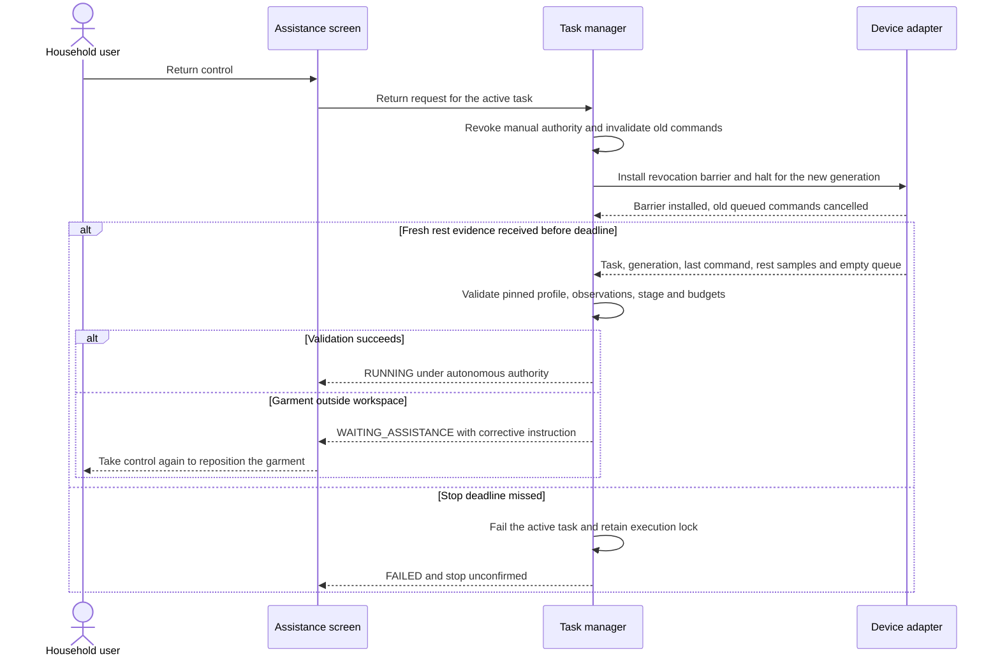

# Self-Correcting Robotic Clothes Folding System
## Assignment 2 · Design working draft

**Review date:** 9 November 2026. **Scope:** the integrated design includes independently reviewed PR27 and PR29 evidence, phase-conditioned monitoring, fresh preflight detection and restricted geometry-verified continuation. PR31 supplies the checkpoint and full RGB; all 958 recorded calls reproduce with identical decisions. PR32 closes the new-normal technical review, and PR33 closes Hu's slides 1–4 content handoff. Ma has confirmed understanding the core design, accepting the personal contribution record and practising the individual slides. This does not confirm another member's assessment, measured effort, whole-team rehearsal or classroom participation. The companion [review and handoff register](delivery-status.md) identifies the owner and closure condition for each section. Earlier component probes and historical experiments retain their original scope.

## A2-01 · Design Summary

<!-- summary:start -->

Part I specified a simulated clothes folding system for household users, with maintenance roles managing configurations and models. The scope remains one supported shirt type on a fixed table, focusing on grasp offset and partial slippage. Thirty product requirements and eighteen acceptance tests remain unchanged. Part II develops logical, deployment and technology architectures, domain and interaction models, five interface screens, decision records, and verification plans. Implementation evidence supports these designs without replacing acceptance conditions.

The task coordinator owns dispatch authority. Detection and recovery workers propose results; the adapter checks execution conditions and reports measurements. Versioned observations, control generations, bounded attempts and persisted acceptance records prevent late proposals from silently regaining authority. The interface separates task state from measured rest. Manual adjustment requires confirmed rest and explicit takeover; returning control requires fresh validation. The browser prototype exercises these interactions using labelled synthetic events and remains separate from actual simulator control.

The development deployment uses Zhang Mingbo's workstation with Isaac Sim 4.5 and DexGarmentLab. The normal controller remains GAM plus scripted actions. Simulation dependencies remain isolated from application and inference environments. Process transport and persistent storage choices remain open. The workstation's limited RAM, shared compute resources and untested distributed failure paths remain architectural risks. Subsequent simulation continues on that workstation without another installation.

The detector adapts FIPER's observation branch using pretrained ResNet18 features and random network distillation. Hu's archived package was independently reproduced, including its normal false alarm. Zhang's subsequent package distinguishes left and right sleeve phases using past controller intent. One normal trial supplies fitting and four supply calibration. A previously viewed development trial is reassigned to calibration. Thresholds, sources and failed development records remain versioned; no statistical guarantee or failure probability is claimed.

A/B/C records connect this design to execution. A completes normal folding without alarms or recovery. In B, an RGB alarm requests preflight; after measured rest and nominal path checks, a new image reconfirms the alert. Five macro operations produce sixty-one dispatches. Post-macro monitoring yields twelve warmup reports and one HELD window. A separate generation baseline precedes twenty-three continuation checkpoints using declared simulation geometry. During this restricted continuation, fresh holding geometry can support progress despite an unchanged RGB anomaly report. Both channels retain independent records. The final regional proxy contains 2002 of 2048 points. C returns UNKNOWN for missing detector inputs and requests help without further dispatch. These are development cases, not a recovery-benefit comparison or product-quality certification.

Independent review checks logs, source snapshots, geometry, regional counts and video provenance. Recorded detector-call processing has a median of approximately 32 milliseconds and a maximum of 63 milliseconds in A and B; this excludes unmeasured system queues, UI and exposure latency. Shared checkpoint and RGB now reproduce all recorded decisions within declared numerical tolerance. Design refinements preserve validation origins and distinguish human judgement, alarms and stop acceptance times. AI-assisted material requires source checks, counterexamples and attribution. Ma confirms understanding and slide practice. User evaluation, rehearsal and classroom-feedback revision remain; full product validation is reserved for Part III.
<!-- summary:end -->

[Editorial check: 500 words, identical to the marked summary in Ma's integration material. Execution evidence is reviewed through PR32; PR33 supplies the UI presentation handoff, and the owner-confirmation record supplies Ma's personal preparation status. Actual user sessions, whole-team rehearsal and classroom feedback remain unrecorded.]

## A2-02 · Architecture and key decisions

The [logical, deployment and technology views](architecture-presentation-draft.md), [recovery components and sequences](recovery-design.md), [message contracts](interfaces.md) and [decision records](decisions/ADR-MA-005-measured-input-and-branch-validity.md) form the integration baseline. The deployment uses Zhang’s existing workstation for simulation; the browser UI remains a local event harness. Planned service boundaries must be distinguished from the single-process probes already measured.

The current diagnostic protocol is specified in [the runtime contract](pre-current-runtime-contract.md) and [ADR-MA-007](decisions/ADR-MA-007-phase-conditioned-detection-and-verified-continuation.md). Past normal commands select left/right sleeve thresholds. Waiting for preflight requires a new anomalous image rather than extending an old clock. After a complete macro, a new hold window, generation and baseline govern the restricted left-sleeve continuation. Its simulation geometry may support continuation despite a retained RGB anomaly. This is a disclosed coordinator decision, not a claim that the vision detector alone remains reliable after recovery.

The user interface displays task state and device state separately. A pause blocks new autonomous dispatch. The task manager must still receive evidence of rest from the adapter before it can grant manual authority. This division of responsibility addresses a specific failure: a delayed acknowledgement could otherwise make the interface invite a user to touch a garment while a gripper is moving. A policy result arriving from an earlier control generation must be discarded.

The local prototype represents these boundaries within a single browser session. Its event controls let a reviewer provide an acknowledgement, a timeout or a disconnection at a chosen step. This makes an ordering error observable during design review. Transport delay, process failure, billing and resource release require separate implementation evidence.

The adopted recovery contract defines authority, candidate rejection and measured rest. Ma’s seven decision records cover control, history, reproducibility, platform choice, observation monitoring and restricted continuation. The UI mapping and independent sample review connect those decisions to the household screens and intake fields. [Logical interfaces](interfaces.md) · [UI and record contract](ui-contract.md) · [Single-frame review](observation-review.md) · [Owner materials](ma-assignment2-material.md)

The logical and deployment views locate ownership and the intended process boundaries. The technology view distinguishes the Isaac runtime, inference worker and evidence stores. The storage engine and production transport remain design choices for Part III. [Logical and deployment views](architecture-presentation-draft.md) · [Technology and system interfaces](models/zhang-system-models.md)

## A2-03 · Design models

**Interaction draft for joint review.** A user returning control creates two distinct events: withdrawal of manual authority and permission to resume folding. Between them the task manager obtains new stop evidence and validates the current fold stage. The sequence below is a proposed component interaction derived from the accepted interface flow. The component owners still need to confirm the messages and their payloads.

**Result and replay draft.** When the task manager commits a terminal outcome, it records the task, version references and terminal counter snapshot. Later stop diagnostics and quality review append evidence linked to that task. The results view reads ordered events for the selected task. Selecting an earlier event changes the displayed historical state. It does not grant control authority. A completed run with human assistance can receive an offline quality pass while its autonomous success flag remains false.

The recording design distinguishes one trial, several detection clips and the candidate actions attached to a decision. Each accepted corrective dispatch consumes an attempt even if interrupted. This lets reviewers reconstruct why a candidate was accepted and what happened to the complete trial. [Recording specification](data-design.md)

The editable system models document domain responsibilities and cardinalities, plus the start, pause, termination, resume, return and model activation sequences. They complement the recovery sequence and the joint review of this working draft. [System models](models/zhang-system-models.md) · [Recovery sequence and rejection paths](recovery-design.md)

The [current diagnostic implementation model](models/pre-diagnostic-models.md) maps those product abstractions to the actual report, request, macro acceptance, operation and SDK-command records. B has one accepted attempt, five operations and 61 linked SDK commands. Its thirteen post-macro reports contain twelve warmup results followed by one HELD window; a separate thirteen-report baseline establishes the new generation before twenty-three continuation checkpoints. Neither sample counts nor overlapping windows represent independent recovery successes. A source-bound event analysis checks these identities and prevents double-counting the preflight report saved in two logs.

## A2-04 · Updated requirements

The effective specification contains 16 functional, seven nonfunctional and seven AI requirements. A comparison against the editable English source and final submission confirmed the 44 direct requirement–test links in Appendix A. The October feedback is attributed to Teaching Assistant Wang Zhongkai in the final repository version. Its scope decision and earlier requirements revisions are recorded in Part I.

Under the team leader’s authorization, CR-01 and CR-02 are accepted as development-design refinements. Request and task records retain validation origins and failed checks; development cases distinguish offline intervention judgement, system alarm and stop acceptance, including clock domains and missing evidence. These fields do not alter the thirty product requirements, eighteen acceptance tests or existing thresholds. Local diagnostic reporting uses S/A with explicit unknown outcomes and coverage. Implementation and independent review remain pending. [Decision and rationale](decisions/ADR-MA-005-measured-input-and-branch-validity.md) [Baseline and changes](requirements-changes.md) · [Requirements and tests](traceability.md)

[Team: review affected message and data contracts. Record actual presentation feedback and its disposition when available.]

## A2-05 · User interface and experience

| Screen | User decision | Feedback and guard |
| --- | --- | --- |
| S01 Prepare | Is the scene ready to start? | Confirm the supported garment and clear table. A rejected or cancelled start creates no task outcome. |
| S02 Monitor | Should folding continue, pause or request help? | Show the task, stop state, shared recovery count, active simulation time and resource cost. Continuing requires confirmed rest and successful validation. |
| S03 Assistance | Who controls the garment now? | A confirmed stop and explicit takeover enable adjustment. A failed return identifies the problem and requires another takeover. |
| S04 Results | What ended, and was the fold successful? | Present runtime outcome, help, manual intervention and offline quality separately. Replay reads prior events. |
| S05 Maintain | Can this candidate or configuration affect the next task? | Lock maintenance changes during an active task, a pending start or an unresolved stop. A new task captures the approved version. |

The local prototype was exercised in Chrome, including independent review through a local HTTP entry point. The checks covered recovery interrupted by a pause, a rejected human return followed by a second takeover, different responses to interface and adapter loss, and a stop timeout after termination. A facilitator script and anonymous forms are ready. User comments, observed misunderstandings and resulting changes await actual sessions. [Runnable prototype](../../prototypes/ui/index.html) · [Interaction checks](interaction-design.md) · [Walkthrough materials](user-walkthrough.md)

## A2-06 · Open issues and risks

**Measured update.** PR29 adds normal, alarm-triggered recovery and missing-package cases; the execution/geometry/point-cloud/video evidence was independently checked. PR31 shared the new weights and complete RGB, and independent score reproduction passed. Simulation geometry supports the restricted continuation. Recorded detection-call medians are approximately 32 ms and maxima 63 ms, excluding unmeasured product queues and exposure/UI latency. Transport and product coordinator integration remain unverified. Settled reset differences reach 31.7 mm, so A/B must not be presented as identical-state causal recovery comparisons. Statistical detection, formal quality and learned recovery-ranking experiments remain open. [PR29 review](../reviews/pr29-review.md) · [Runtime measurements](../research/evidence/ma-pr29-runtime-measurements-20261109.json) · [Current protocol](pre-current-runtime-contract.md) · [Updated risk register](ma-risks-and-validation.md)

| Open question and consequence | Proposed check and decision rule | Owner to confirm |
| --- | --- | --- |
| Can a first-time user distinguish “paused” from “safe to adjust”? A misunderstanding could lead the user to reach in early. | Observe at least two prospective users separately. Record the first interpretation before the facilitator supplies stop evidence. Any early assumption of manual authority triggers a wording or layout review and a separately labelled retest. Formal T13 timing remains outstanding. | Hu, with Zhang checking the stop semantics |
| Can the adapter supply valid stop evidence by the deadline? A missing acknowledgement can leave the task terminal while the execution lock remains active. | In Part III, test stale generation, a nonempty queue, residual motion and missed proof. Reject invalid proof, preserve the lock and require fresh evidence. Compare measured wall time with the one-second requirement. Review the adapter or action bounds if it fails. | Zhang |
| Can quality be assessed across the reserved garments? A local regrasp can succeed while the final fold fails. | Map the eight landmarks and apply the registered stability and error bounds to counterexamples such as an unfolded sleeve. Missing targets yield NOT_ASSESSED. Review the metric on validation cases before final-test access. | Ma with Hu on labels and Zhang on assets |

[System risk, test criteria and fallbacks](zhang-assignment2-material.md#part-iii-validation) · [Research validation plan](ma-risks-and-validation.md)

## A2-07 · AI tools reflection

The latest AI-assisted review went beyond accepting generated manifests and green tests. A modified-image fixture with rebuilt internal checksums exposed PR27's missing binding to the previously reviewed source manifest. The revised source gate rejected that fixture before image loading and encoding. In PR29, replaying the supplied geometry measurements exposed harmless floating-point tail differences: identity, timing and status were checked strictly while derived distances were compared with an explicit tiny tolerance. PR31 subsequently shared the new checkpoint and RGB; all 958 recorded calls reproduced with explicit score tolerance and exact decision checks. These examples show why source provenance, counterexamples and the scope of each verifier matter.

Codex assisted with source extraction, drafting, implementation and repeatable checks in this workstream. An early progress message supplied an unverified Chinese rendering of Wang Zhongkai’s name. Comparing the two English specifications established the attribution in the repository copy, and the report uses the spelling and role in that document. This affects how the team credits the October feedback.

Browser automation also required scrutiny. Its first run retained references to checkboxes after the interface had redrawn them. The test then reported that Start was unavailable. The script was changed to locate each current checkbox before clicking it, and the full sequence was rerun. The failure concerned the test procedure; the rerun established the prototype behaviour for that path. Neither automated clicks nor generated recording forms can establish how a first-time participant understood the interface.

[Zhang’s evidence-based reflection draft](zhang-assignment2-material.md#contribution-and-ai-reflection-for-owner-confirmation) records the lighting and launcher corrections. Each owner still needs to confirm their personal assessment and any attributable effort. [Evidence and provenance](delivery-status.md)

## A2-08 · Annotated references

The source annotations explain how the design uses evidence on recovery, monitoring, simulation, garment readiness and staged continuation. The final editor will consolidate actually used sources, check the primary papers and verify 200–300 words per final entry. [Existing reference register, including DexGarmentLab](../research/annotated-references.md) · [APS-Net and AgentChord annotations](zhang-assignment2-material.md#l02--learning-efficient-robotic-garment-manipulation-with-standardization) · [Source register](../research/source-register.md)

## A2-09 · Team member contributions

Ma has now confirmed understanding the current core design, accepting the personal contribution record and practising the individual slides. This is an explicit owner statement, separate from repository evidence. It does not confirm measured effort, another member's contribution, whole-team timing or classroom attendance. [Owner confirmation](ma-owner-confirmation-20261109.md)

Current evidence adds distinct workstreams: Hu supplied the independently reproduced PR27 full detection package; Zhang implemented and captured the later phase-conditioned A/B/C diagnostic, including macro preflight, geometry continuation and video. Ma's AI-assisted workstream supplied the detector/recovery interfaces and independently audited provenance, model reproduction where accessible, execution records, geometry, regional outcomes and video alignment. ADR-MA-007, the current runtime contract and recorded timing analysis integrate these findings into the design. Personal contribution confirmation, understanding, presentation attendance and classroom feedback are not inferred from repository artifacts.

The materials assembled for Hu Zhiyu’s assigned workstream comprise the literature reading brief, the offline five-screen interaction flow, a baseline comparison and traceability matrix, the recording and evaluation protocol, and the walkthrough materials. The local outputs identify which behaviours were exercised with an event harness and which still require participant or simulator evidence. The [presentation handoff](hu-presentation-handoff.md) supplies two editable slides, sources and speaker notes. The [label review](dr02-label-audit.md) and [full-chain review](full-recovery-proxy-review.md) record the decisions supported by the available data. Participant observations, personal sign-off and the team rehearsal are outstanding.

[Zhang’s workstream record](zhang-assignment2-material.md#contribution-and-ai-reflection-for-owner-confirmation) identifies the submitted environment, experiments and architecture material. Each member still needs to confirm individual contributions, decisions and review activities. Joint approval and individual effort figures remain open.
