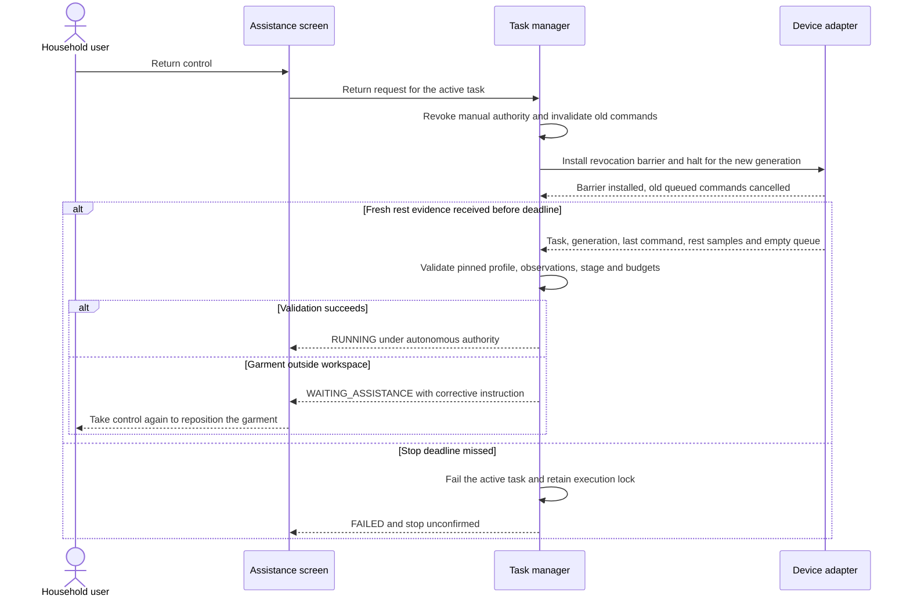

# Self-Correcting Robotic Clothes Folding System
## Assignment 2 · Design working draft

**Review date:** 8 November 2026. **Scope:** integrated working draft after PR #9/#10 (main@627c56b), including Ma’s offline runtime intake and evidence-based decisions. Bracketed review notes identify decisions, authorship or evidence that still need confirmation. The companion [review and handoff register](delivery-status.md) identifies the owner and closure condition for each section.

## A2-01 · Design Summary

Part I specified a simulated clothes folding system for one supported shirt type on a fixed table. The design prioritises grasp offset and partial slippage, bounded recovery, and explicit human assistance. It translates these requirements into three architecture views, five interface screens, recovery contracts and verification procedures. The team retains the original acceptance requirements while recording implementation evidence separately from design decisions.

The recovery worker proposes actions; the task coordinator owns execution authority. Before accepting a segment, the coordinator checks the current control generation, observation freshness, action constraints, calibration and remaining budgets. The adapter must reject revoked commands and report measured feedback. This separation adds protocol and latency, but allows the recovery method to change without transferring control authority to the model. A score cannot prove rest, and an earlier terminal outcome cannot be overwritten by a late response. The interaction prototype exercises preparation, pause, assistance, return and replay using explicitly synthetic events.

Isaac Sim 4.5 with DexGarmentLab runs on Zhang Mingbo's workstation, where Ma Xianghui completed the basic rerun. Two normal exports comprising 153 frames were received and encoded. Subsequent records provide named joint mappings, a component position command, measured feedback and visible simulated RGB. Ma's offline intake now encodes sixty joint channels, masked histories and sparse absolute targets. It preserves an important limitation: the new RGB was captured after the command and cannot be reused as its decision input. Legacy joint ordering is not retrospectively declared verified.

A single-process adapter probe records dispatch acknowledgement, deduplication, generation rejection and measured stopping. Independent recalculation gives pause and termination confirmation delays of approximately 0.676 and 0.692 seconds. The submitted windows cover all sixty rotational joints and satisfy the probe's recorded sampling and speed conditions. These results support component feasibility; they do not verify transport queues, disconnection handling or the complete product coordinator. Fold Tops images and a three-target projection check support camera integration. The upstream success flag remains distinct from the system's quality and autonomy criteria.

Repeated initial resets produced maximum settled mesh differences of approximately 31.7 millimetres. The design therefore requires mid-task state, velocity and contact checks before treating recovery branches as comparable. If these checks fail, independent blocked trials replace claims about identical-state candidate choices. Research questions about history and continuation quality remain open because labelled failure and recovery branches are unavailable. Local diagnostic reporting uses confirmed recoveries over accepted actions, with unknown outcomes and coverage shown separately. Additional development records distinguish validation origins, offline human judgements, system alarms and stop acceptance without changing product thresholds.

Current deliverables include decision records, editable diagrams, grouped-data safeguards, baseline and preflight software, annotation procedures and presentation material. The next integration connects real decision-time observations and executed segments to the coordinator, then collects audited grasp-offset and slip cases. Participant walkthroughs, a timed team rehearsal, classroom feedback and final submission remain pending. The final report will incorporate their actual evidence rather than treating generated documents or component tests as proof of a completed system.

[Editorial check: 494 words. Facts updated after PR #9/#10 and Ma runtime intake. Participant, classroom and personal attribution checks remain pending.]

## A2-02 · Architecture and key decisions

The [logical, deployment and technology views](architecture-presentation-draft.md), [recovery components and sequences](recovery-design.md), [message contracts](interfaces.md) and [decision records](decisions/ADR-MA-005-measured-input-and-branch-validity.md) form the integration baseline. The deployment uses Zhang’s existing workstation for simulation; the browser UI remains a local event harness. Planned service boundaries must be distinguished from the single-process probes already measured.

The user interface displays task state and device state separately. A pause blocks new autonomous dispatch. The task manager must still receive evidence of rest from the adapter before it can grant manual authority. This division of responsibility addresses a specific failure: a delayed acknowledgement could otherwise make the interface invite a user to touch a garment while a gripper is moving. A policy result arriving from an earlier control generation must be discarded.

The local prototype represents these boundaries within a single browser session. Its event controls let a reviewer provide an acknowledgement, a timeout or a disconnection at a chosen step. This makes an ordering error observable during design review. Transport delay, process failure, billing and resource release require separate implementation evidence.

The adopted recovery contract defines authority, candidate rejection and measured rest. Ma’s four decision records cover control, history, reproducibility and platform choice. The UI mapping and independent sample review connect those decisions to the household screens and intake fields. [Logical interfaces](interfaces.md) · [UI and record contract](ui-contract.md) · [Single-frame review](observation-review.md) · [Owner materials](ma-assignment2-material.md)

The logical and deployment views locate ownership and the intended process boundaries. The technology view distinguishes the Isaac runtime, inference worker and evidence stores. The storage engine and production transport remain design choices for Part III. [Logical and deployment views](architecture-presentation-draft.md) · [Technology and system interfaces](models/zhang-system-models.md)

## A2-03 · Design models

**Interaction draft for joint review.** A user returning control creates two distinct events: withdrawal of manual authority and permission to resume folding. Between them the task manager obtains new stop evidence and validates the current fold stage. The sequence below is a proposed component interaction derived from the accepted interface flow. The component owners still need to confirm the messages and their payloads.

**Result and replay draft.** When the task manager commits a terminal outcome, it records the task, version references and terminal counter snapshot. Later stop diagnostics and quality review append evidence linked to that task. The results view reads ordered events for the selected task. Selecting an earlier event changes the displayed historical state. It does not grant control authority. A completed run with human assistance can receive an offline quality pass while its autonomous success flag remains false.

The recording design distinguishes one trial, several detection clips and the candidate actions attached to a decision. Each accepted corrective dispatch consumes an attempt even if interrupted. This lets reviewers reconstruct why a candidate was accepted and what happened to the complete trial. [Recording specification](data-design.md)

The editable system models document domain responsibilities and cardinalities, plus the start, pause, termination, resume, return and model activation sequences. They complement the recovery sequence and the joint review of this working draft. [System models](models/zhang-system-models.md) · [Recovery sequence and rejection paths](recovery-design.md)

## A2-04 · Updated requirements

The effective specification contains 16 functional, seven nonfunctional and seven AI requirements. A comparison against the editable English source and final submission confirmed the 44 direct requirement–test links in Appendix A. The October feedback is attributed to Teaching Assistant Wang Zhongkai in the final repository version. Its scope decision and earlier requirements revisions are recorded in Part I.

Under the team leader’s authorization, CR-01 and CR-02 are accepted as development-design refinements. Request and task records retain validation origins and failed checks; development cases distinguish offline intervention judgement, system alarm and stop acceptance, including clock domains and missing evidence. These fields do not alter the thirty product requirements, eighteen acceptance tests or existing thresholds. Local diagnostic reporting uses S/A with explicit unknown outcomes and coverage. Implementation and independent review remain pending. [Decision and rationale](decisions/ADR-MA-005-measured-input-and-branch-validity.md) [Baseline and changes](requirements-changes.md) · [Requirements and tests](traceability.md)

[Team: review affected message and data contracts. Record actual presentation feedback and its disposition when available.]

## A2-05 · User interface and experience

| Screen | User decision | Feedback and guard |
| --- | --- | --- |
| S01 Prepare | Is the scene ready to start? | Confirm the supported garment and clear table. A rejected or cancelled start creates no task outcome. |
| S02 Monitor | Should folding continue, pause or request help? | Show the task, stop state, shared recovery count, active simulation time and resource cost. Continuing requires confirmed rest and successful validation. |
| S03 Assistance | Who controls the garment now? | A confirmed stop and explicit takeover enable adjustment. A failed return identifies the problem and requires another takeover. |
| S04 Results | What ended, and was the fold successful? | Present runtime outcome, help, manual intervention and offline quality separately. Replay reads prior events. |
| S05 Maintain | Can this candidate or configuration affect the next task? | Lock maintenance changes during an active task, a pending start or an unresolved stop. A new task captures the approved version. |

The local prototype was exercised in Chrome, including independent review through a local HTTP entry point. The checks covered recovery interrupted by a pause, a rejected human return followed by a second takeover, different responses to interface and adapter loss, and a stop timeout after termination. A facilitator script and anonymous forms are ready. User comments, observed misunderstandings and resulting changes await actual sessions. [Runnable prototype](../../prototypes/ui/index.html) · [Interaction checks](interaction-design.md) · [Walkthrough materials](user-walkthrough.md)

## A2-06 · Open issues and risks

**Measured update.** Component I/O and stop records now exist; transport and coordinator integration remain unverified. Settled reset differences reach 31.7 mm, preventing an identical-state branch claim. Decision-time RGB, executed-history linkage, failure labels and recovery outcomes remain missing. [Measured integration](../research/runtime-component-integration.md) · [Updated risk register](ma-risks-and-validation.md) · [Branch-validity decision](decisions/ADR-MA-005-measured-input-and-branch-validity.md)

| Open question and consequence | Proposed check and decision rule | Owner to confirm |
| --- | --- | --- |
| Can a first-time user distinguish “paused” from “safe to adjust”? A misunderstanding could lead the user to reach in early. | Observe at least two prospective users separately. Record the first interpretation before the facilitator supplies stop evidence. Any early assumption of manual authority triggers a wording or layout review and a separately labelled retest. Formal T13 timing remains outstanding. | Hu, with Zhang checking the stop semantics |
| Can the adapter supply valid stop evidence by the deadline? A missing acknowledgement can leave the task terminal while the execution lock remains active. | In Part III, test stale generation, a nonempty queue, residual motion and missed proof. Reject invalid proof, preserve the lock and require fresh evidence. Compare measured wall time with the one-second requirement. Review the adapter or action bounds if it fails. | Zhang |
| Can quality be assessed across the reserved garments? A local regrasp can succeed while the final fold fails. | Map the eight landmarks and apply the registered stability and error bounds to counterexamples such as an unfolded sleeve. Missing targets yield NOT_ASSESSED. Review the metric on validation cases before final-test access. | Ma with Hu on labels and Zhang on assets |

[System risk, test criteria and fallbacks](zhang-assignment2-material.md#part-iii-validation) · [Research validation plan](ma-risks-and-validation.md)

## A2-07 · AI tools reflection

Codex assisted with source extraction, drafting, implementation and repeatable checks in this workstream. An early progress message supplied an unverified Chinese rendering of Wang Zhongkai’s name. Comparing the two English specifications established the attribution in the repository copy, and the report uses the spelling and role in that document. This affects how the team credits the October feedback.

Browser automation also required scrutiny. Its first run retained references to checkboxes after the interface had redrawn them. The test then reported that Start was unavailable. The script was changed to locate each current checkbox before clicking it, and the full sequence was rerun. The failure concerned the test procedure; the rerun established the prototype behaviour for that path. Neither automated clicks nor generated recording forms can establish how a first-time participant understood the interface.

[Zhang’s evidence-based reflection draft](zhang-assignment2-material.md#contribution-and-ai-reflection-for-owner-confirmation) records the lighting and launcher corrections. Each owner still needs to confirm their personal assessment and any attributable effort. [Evidence and provenance](delivery-status.md)

## A2-08 · Annotated references

The source annotations explain how the design uses evidence on recovery, monitoring, simulation, garment readiness and staged continuation. The final editor will consolidate actually used sources, check the primary papers and verify 200–300 words per final entry. [Existing reference register, including DexGarmentLab](../research/annotated-references.md) · [APS-Net and AgentChord annotations](zhang-assignment2-material.md#l02--learning-efficient-robotic-garment-manipulation-with-standardization) · [Source register](../research/source-register.md)

## A2-09 · Team member contributions

The materials assembled for Hu Zhiyu’s assigned workstream comprise the literature reading brief, the offline five-screen interaction flow, a baseline comparison and traceability matrix, the recording and evaluation protocol, and the walkthrough materials. The local outputs identify which behaviours were exercised with an event harness and which still require participant or simulator evidence. This working draft adds editorial coordination and a review register.

[Zhang’s workstream record](zhang-assignment2-material.md#contribution-and-ai-reflection-for-owner-confirmation) identifies the submitted environment, experiments and architecture material. Each member still needs to confirm individual contributions, decisions and review activities. Joint approval and individual effort figures remain open.
