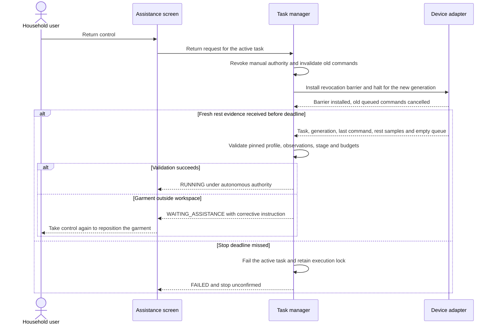

# Self-Correcting Robotic Clothes Folding System
## Assignment 2 · Design working draft

**Review date:** 8 November 2026. **Scope:** Hu Zhiyu’s interaction and evaluation materials at hzy@2268c713 and main@1411e82c. Bracketed review notes identify decisions, authorship or evidence that still need confirmation. The companion [review and handoff register](delivery-status.md) identifies the owner and closure condition for each section.

## A2-01 · Design Summary

Part I specified a simulated robot that folds one supported type of shirt on a fixed table. It identified two faults worth addressing first: a grasp that closes away from its intended patch and a partial slip after the robot has established a hold. The teaching assistant recognised the value of detecting and recovering from these faults and questioned how much the group could implement. The design therefore separates a working control loop from the later evaluation of a learned recovery policy. The evidence assembled for this review concerns interaction design, requirements traceability and evaluation procedures.

The five interface sketches now share a task record in a runnable local prototype. A household user can prepare a task, monitor folding, request assistance and inspect the result. A maintainer can examine the conditions for changing a model or configuration between tasks. The distinction between a pause and a confirmed stop matters most when a user reaches for the garment. The prototype first shows that the task has stopped issuing actions. Manual adjustment becomes available only after the device reports rest and the user takes control. Returning control requires fresh evidence of rest after the manual action. If the garment is outside the workspace, the interface explains the failed check and returns the user to assistance. Browser checks exercised these transitions using simulated device events.

The requirements review traced thirty requirements to eighteen acceptance tests in the final English specification. The local and repository copies differ in how they attribute earlier feedback. Their requirement clauses and acceptance tests agree. Two proposed revisions remain open. One would retain the failed check and validation origin for later review. The other would distinguish the time when a reviewer first sees a need to intervene from the system alarm and the acceptance of a stop request. Both proposals require review before they can change an acceptance decision.

The evaluation design separates a detection clip, a corrective action and a complete trial. A robot may regain its grip but leave a sleeve outside the intended fold. That case can support a local recovery label while still counting as an unsuccessful autonomous trial. The proposed recording sheets preserve that distinction and link disagreements to the original evidence. They also keep failures that occur before a scheduled disturbance in the trial denominator. The procedure reserves garment instances and related trajectories together to protect the final comparison from reuse of development examples.

The team selected DexGarmentLab on Isaac Sim and adopted a logical recovery contract. Ma completed the basic rerun on Zhang's workstation. The team verified two normal demonstrations containing 153 frames and encoded their RGB, joint and stage history inputs. The available records support inspection of observations. Actual command acknowledgements, measured stop evidence and labelled recovery branches still require collection. The prototype now audits late replies and deduplicates replies within a control generation. Its exported event sequence identifies synthetic inputs. The team has a draft covering three architecture views and materials for a walkthrough with prospective users.

[Editorial check: 497 words in the five paragraphs above. Ma Xianghui to verify project and research facts. Zhang Mingbo to verify architecture and implementation status. Update following actual walkthrough and classroom feedback, then recount.]

## A2-02 · Architecture and key decisions

The user interface displays task state and device state separately. A pause blocks new autonomous dispatch. The task manager must still receive evidence of rest from the adapter before it can grant manual authority. This division of responsibility addresses a specific failure: a delayed acknowledgement could otherwise make the interface invite a user to touch a garment while a gripper is moving. A policy result arriving from an earlier control generation must be discarded.

The local prototype represents these boundaries within a single browser session. Its event controls let a reviewer provide an acknowledgement, a timeout or a disconnection at a chosen step. This makes an ordering error observable during design review. Transport delay, process failure, billing and resource release require separate implementation evidence.

The adopted recovery contract defines authority, candidate rejection and measured rest. Ma’s four decision records cover control, history, reproducibility and platform choice. The UI mapping and independent sample review connect those decisions to the household screens and intake fields. [Logical interfaces](interfaces.md) · [UI and record contract](ui-contract.md) · [Single-frame review](observation-review.md) · [Owner materials](ma-assignment2-material.md)

[Zhang: integrate the [three architecture views and decision narrative](architecture-presentation-draft.md) into the final design and review the process, storage and failure boundaries. Ma: cross-check the UI mapping against the adopted recovery contract and confirm its implementation boundary. For each unresolved choice, state its owner and the observation that would change the decision.] [Part I system models](https://github.com/MXH814/self-correcting-robotic-clothes-folding-system/blob/4191e8f5d9f065dd009367f83572693141c4d551/submissions/assignment-1/Group3_Assignment1_SRS/Models/Group3_Models.drawio)

## A2-03 · Design models

**Interaction draft for joint review.** A user returning control creates two distinct events: withdrawal of manual authority and permission to resume folding. Between them the task manager obtains new stop evidence and validates the current fold stage. The sequence below is a proposed component interaction derived from the accepted interface flow. The component owners still need to confirm the messages and their payloads.

**Result and replay draft.** When the task manager commits a terminal outcome, it records the task, version references and terminal counter snapshot. Later stop diagnostics and quality review append evidence linked to that task. The results view reads ordered events for the selected task. Selecting an earlier event changes the displayed historical state. It does not grant control authority. A completed run with human assistance can receive an offline quality pass while its autonomous success flag remains false.

The recording design distinguishes one trial, several detection clips and the candidate actions attached to a decision. Each accepted corrective dispatch consumes an attempt even if interrupted. This lets reviewers reconstruct why a candidate was accepted and what happened to the complete trial. [Recording specification](data-design.md)

[Zhang: integrate the domain and structural models, component responsibilities, cardinalities and remaining sequences, including start, pause, termination and model activation. Integrate the [recovery sequence and rejection paths](recovery-design.md). Verify the above draft against the implementation contract.]

## A2-04 · Updated requirements

The effective specification contains 16 functional, seven nonfunctional and seven AI requirements. A comparison against the editable English source and final submission confirmed the 44 direct requirement–test links in Appendix A. The October feedback is attributed to Teaching Assistant Wang Zhongkai in the final repository version. Its scope decision and earlier requirements revisions are recorded in Part I.

Two design proposals are deferred for review. CR-01 would retain the validation origin and failed check in request or task history. CR-02 would add distinct timestamps for offline intervention judgement, system alarm and stop acceptance, with their clock domains. The existing requirements remain the acceptance baseline pending a recorded decision. The review identifies no newly approved product change. [Baseline and changes](requirements-changes.md) · [Requirements and tests](traceability.md)

[Team: review affected message and data contracts. Record actual presentation feedback and its disposition when available.]

## A2-05 · User interface and experience

| Screen | User decision | Feedback and guard |
| --- | --- | --- |
| S01 Prepare | Is the scene ready to start? | Confirm the supported garment and clear table. A rejected or cancelled start creates no task outcome. |
| S02 Monitor | Should folding continue, pause or request help? | Show the task, stop state, shared recovery count, active simulation time and resource cost. Continuing requires confirmed rest and successful validation. |
| S03 Assistance | Who controls the garment now? | A confirmed stop and explicit takeover enable adjustment. A failed return identifies the problem and requires another takeover. |
| S04 Results | What ended, and was the fold successful? | Present runtime outcome, help, manual intervention and offline quality separately. Replay reads prior events. |
| S05 Maintain | Can this candidate or configuration affect the next task? | Lock maintenance changes during an active task, a pending start or an unresolved stop. A new task captures the approved version. |

The local prototype was exercised in Chrome through its ordinary file entry point. The checks covered recovery interrupted by a pause, a rejected human return followed by a second takeover, different responses to interface and adapter loss, and a stop timeout after termination. A facilitator script and anonymous forms are ready. User comments, observed misunderstandings and resulting changes await actual sessions. [Runnable prototype](../../prototypes/ui/index.html) · [Interaction checks](interaction-design.md) · [Walkthrough materials](user-walkthrough.md)

## A2-06 · Open issues and risks

| Open question and consequence | Proposed check and decision rule | Owner to confirm |
| --- | --- | --- |
| Can a first-time user distinguish “paused” from “safe to adjust”? A misunderstanding could lead the user to reach in early. | Observe at least two prospective users separately. Record the first interpretation before the facilitator supplies stop evidence. Any early assumption of manual authority triggers a wording or layout review and a separately labelled retest. Formal T13 timing remains outstanding. | Hu, with Zhang checking the stop semantics |
| Can the adapter supply valid stop evidence by the deadline? A missing acknowledgement can leave the task terminal while the execution lock remains active. | In Part III, test stale generation, a nonempty queue, residual motion and missed proof. Reject invalid proof, preserve the lock and require fresh evidence. Compare measured wall time with the one-second requirement. Review the adapter or action bounds if it fails. | Zhang |
| Can quality be assessed across the reserved garments? A local regrasp can succeed while the final fold fails. | Map the eight landmarks and apply the registered stability and error bounds to counterexamples such as an unfolded sleeve. Missing targets yield NOT_ASSESSED. Review the metric on validation cases before final-test access. | Ma with Hu on labels and Zhang on assets |

[Owners: reconcile the active risk register with [Ma’s validation plan](ma-risks-and-validation.md), including measured capacity and outstanding platform checks. Record agreed fallback and review point.]

## A2-07 · AI tools reflection

Codex assisted with source extraction, drafting, implementation and repeatable checks in this workstream. An early progress message supplied an unverified Chinese rendering of Wang Zhongkai’s name. Comparing the two English specifications established the attribution in the repository copy, and the report uses the spelling and role in that document. This affects how the team credits the October feedback.

Browser automation also required scrutiny. Its first run retained references to checkboxes after the interface had redrawn them. The test then reported that Start was unavailable. The script was changed to locate each current checkbox before clicking it, and the full sequence was rerun. The failure concerned the test procedure; the rerun established the prototype behaviour for that path. Neither automated clicks nor generated recording forms can establish how a first-time participant understood the interface.

[Hu: verify this account against the work record and add any personal assessment, edits, time and attributable cost that can be substantiated. Ma: verify the supplied workstream reflection. Zhang: confirm the scope of the available records and provide your reflection. The work record contains no reliable breakdown of individual hours, tokens or charges.] [Evidence and provenance](delivery-status.md)

## A2-08 · Annotated references

[Pending. The reference owners must select sources used in the design, provide their own annotations and verify the required 200–300 words for each entry. No English annotations have been drafted in this workstream.]

## A2-09 · Team member contributions

The materials assembled for Hu Zhiyu’s assigned workstream comprise the literature reading brief, the offline five-screen interaction flow, a baseline comparison and traceability matrix, the recording and evaluation protocol, and the walkthrough materials. The local outputs identify which behaviours were exercised with an event harness and which still require participant or simulator evidence. This working draft adds editorial coordination and a review register.

[Hu: confirm personal authorship, decisions and review activities before attribution. Ma: confirm attribution of the supplied workstream record. Zhang: confirm personal contributions with evidence, including reviews. Joint approval and individual effort figures remain open.]
