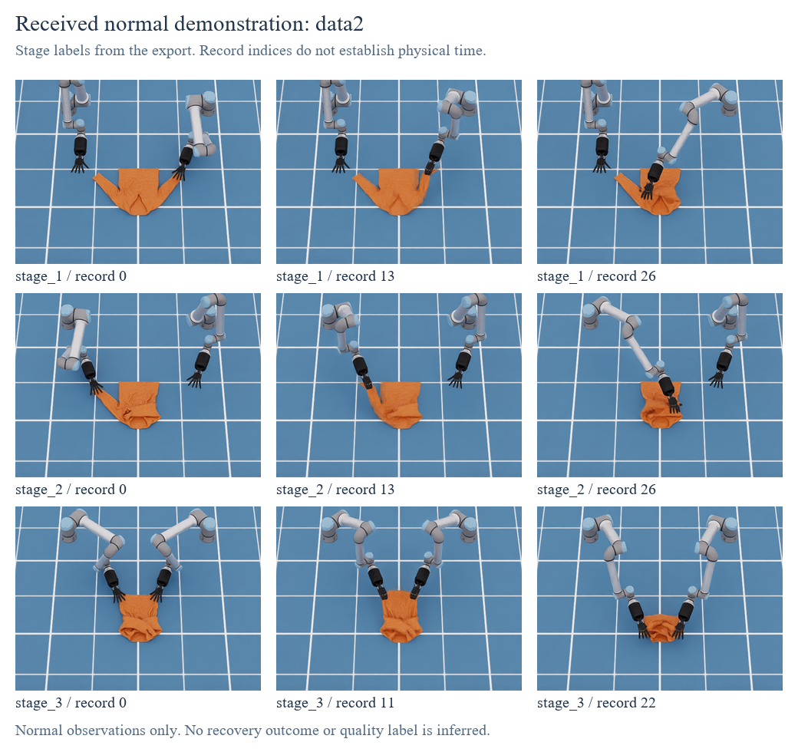
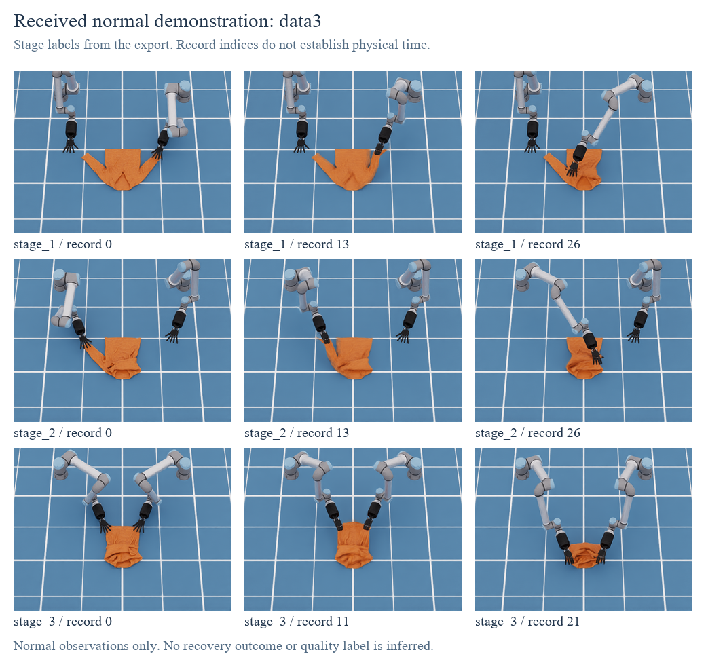

# 真实正常轨迹：观测编码与历史接入结果

2026-11-08，马祥珲分工。已对PR #7实际接收的data2/data3执行固定RGB编码和阶段内历史构造。此为真实数据工程接入结果；没有训练恢复模型，没有新增恢复标签、候选分支或H1/H2结论。

## 已实际运行

| 项目 | 结果 |
| --- | --- |
| 来源 | data2 77帧（27/27/23）；data3 76帧（27/27/22），来源指纹沿用[接收审核](evidence/ma-release-intake-audit-20261108.json) |
| 当前图像 | 原RGB纯数值数组，固定8×8网格、每格RGB均值、除255、按行展开为192维；不拟合参数或使用外部checkpoint |
| 本体状态 | 保留每帧60维原始值；不猜关节名/单位，不把相邻状态差当执行动作 |
| 历史 | 前4条记录，不含当前、不跨阶段；历史图像768维、原始关节240维、4位有效mask |
| 真实时间/动作 | 缺失，保持null；记录序号不换算秒，历史记录不冒充4个实际执行前缀边界 |
| 输出 | 153行`features.jsonl`及最后写入的完成manifest，位于忽略目录`runs/ma-20261108-normal-features/` |
| 来源与可复用性 | manifest记录源轨迹/记录/manifest指纹、特征定义与输出hash；输出已存在即拒绝覆盖，重复源拒绝 |
| 软件检查 | PR #8整合后49项Python测试通过，包含新增6项编码/边界测试、2项preflight类型检查及1项资产核验测试；软件fixture和真实接入分别记账 |

机器可读结果见[特征接入证据](evidence/ma-normal-feature-integration-20261108.json)。这是来源及数值处理检查，不能证明相机标定/时钟同步或关节物理语义正确。

## 复跑入口

```powershell
python -m research_tools.legacy_features `
  --input-dir tmp/pr6-7-review-20261108/extracted/data2 `
  --input-dir tmp/pr6-7-review-20261108/extracted/data3 `
  --output-dir runs/ma-normal-features-rerun `
  --grid 8 --history 4
```

依赖本机已有NumPy；不需要Isaac或GPU。不自动下载数据，路径按实际接收目录修改；输出目录必须不存在。源码：[legacy_features.py](../../research_tools/legacy_features.py)，边界检查：[tests](../../tests/test_legacy_features.py)。新输出schema为`legacy-observation-features/1`，与恢复候选诊断schema分开，现有诊断工具会拒绝把这些正常帧当候选。

编码器是无学习参数的空间RGB基线，用于输入/缓存/历史接线。它不提供衣物关键点、接触状态、语义或可迁移恢复能力；后续可替换为经过公平控制的冻结编码器。关节归一化和候选动作编码等待真实profile，不在本批悄悄训练归一化器。

## 真实帧预览

每阶段取第一、中间及最后记录；只缩放显示，不添加成败标签，不把最后记录等同质量验收。预览来源及图像hash见[索引](figures/preview-index.json)。





这两条作者记录属于同一支持衣物配置；153帧不是153次独立试验。逐图hash不同也不证明独立样本或泛化覆盖。本批不创建训练/验证划分，不拟合标签或做成功率统计。

## 已能继续与仍缺的输入

已能继续真实RGB/关节读取、固定编码、历史缓存及可视化，后续编码器可以保持相同血缘/缺测接口替换。

用户已确认在张电脑完成基础复跑，后续仿真/采集/恢复闭环统一使用该电脑，不再把环境安装或重复基础复跑列为缺口。尚缺真实通道、相机/时间和已执行动作，抓偏/滑移与可比重置，合法候选、固定接续控制器及局部/最终标签。张提供实际运行/采集，胡审核标签，马继续候选编码和H1/H2比较。正常数据接入与基础复跑已完成，恢复研究仍待有效实验。
