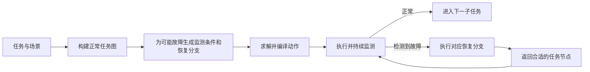

# 衣物操作与故障恢复：三篇论文组会汇报

汇报人：张茗博  
论文：DexGarmentLab、APS-Net、AgentChord  
建议时长：约 15–20 分钟，可根据讨论压缩。本文根据已有精读笔记整理；论文实验结果均为作者报告，相关结论仍需汇报人确认并由组员复核。

---

## 一、汇报主线：从正常操作到故障恢复

我们要解决的叠衣问题可以拆成三个相互关联的问题：衣服如何被稳定操作？开始折叠前，衣物是否处于合适的状态？执行中出现故障后，系统如何继续完成任务？

| 论文 | 主要问题 | 核心思路 | 与本项目的联系 |
|---|---|---|---|
| DexGarmentLab | 不同衣物形状和变形条件下，如何生成示范并学习灵巧操作？ | 仿真环境、自动示范生成，以及 GAM + 扩散策略组成的 HALO | 提供研究正常衣物操作的环境和方法参考 |
| APS-Net | 衣服展开后如何进一步对齐，变成适合折叠的状态？ | 用甩动和抓放进行展开、标准化，再依据关键点折叠 | 提供折叠前准备状态和评价指标的思路 |
| AgentChord | 长任务中发生故障后，如何尽快恢复并继续？ | 构造任务图，提前设计监测条件和恢复分支 | 提供故障监测和恢复流程组织的思路 |

**讲解提示：** 三篇论文分别侧重操作、准备和恢复，可以互相启发；它们使用的环境、任务与评价标准不同，结果不能直接横向排名。

---

## 二、DexGarmentLab：衣物仿真与灵巧操作

**论文：** Yuran Wang 等，*DexGarmentLab: Dexterous Garment Manipulation Environment with Generalizable Policy*，NeurIPS 2025。  
**资料：** [论文](https://papers.nips.cc/paper_files/paper/2025/file/c20ac0df6c213db6d3a930fe9c7296c8-Paper-Conference.pdf)｜[代码](https://github.com/wayrise/DexGarmentLab)｜[官方数据和资产](https://huggingface.co/datasets/wayrise/DexGarmentLab)

### 2.1 论文解决什么问题？

衣服是柔性物体，同一件衣服在不同摆放和变形状态下，袖口、衣领等位置都会变化。机器人如果只机械地重复固定抓取点，就可能抓错；而为每件衣服单独采集大量人工示范，成本又很高。

作者的思路是建立可操作衣物的仿真环境，利用少量示范生成更多数据，再训练能够参考衣物结构选择操作点和动作的策略。

### 2.2 方法如何工作？

1. **环境与资产。** 论文提供双臂、灵巧手、衣物和场景等仿真要素。衣物来自不同类别，系统可记录图像、点云和机器人状态。
2. **自动示范生成。** 人工提供的示范包含抓取点、任务顺序和手势等信息；系统将操作点映射到新衣物，结合运动控制执行并记录轨迹。因此，自动采集仍依赖事先提供的示范知识。
3. **GAM：Garment Affordance Model。** 输入示范衣物与目标衣物的点云、示范抓取点，通过点特征相似度找到目标衣物上的对应操作位置。可以把它理解为“在这件新衣服上，哪里相当于示范中的袖口或其他操作点”。
4. **SADP：结构感知扩散策略。** 在衣物点云、操作点相关特征、环境点云和机器人状态等条件下，生成后续动作序列。GAM 与 SADP 组合形成 HALO：先确定与衣物结构有关的操作区域，再生成动作。

**输入与输出：** 以 HALO 为例，输入涉及点云、机器人关节状态和示范相关信息；输出是操作点及后续机器人动作。其输入不能简单说成“只输入一张 RGB 图片”。

### 2.3 实验是怎么做的？结果如何？

- 论文环境覆盖 **8 类衣物、15 种任务**，主实验表报告 **14 项任务**。作者称衣物资产选自 ClothesNet 的 2500 多件模型。
- 作者报告每个任务采集 **100 条示范**；主表每项任务以 **50 个 episode、3 个随机种子**报告成功率均值和标准差。示范数量与评测次数不是同一个概念。
- 以 Fold Tops 为例，流程为先折左袖、再折右袖、最后折衣身；论文还说明了随机初始位置与成功判定方法。

| Fold Tops 方法 | 成功率：均值 ± 标准差 |
|---|---:|
| DP | 0.53 ± 0.05 |
| DP3 | 0.52 ± 0.06 |
| 不使用 GAM | 0.65 ± 0.02 |
| 不使用 SADP | 0.53 ± 0.09 |
| **HALO** | **0.81 ± 0.03** |

来源：论文第 8 页表 2。这个结果支持作者在其设置下使用 GAM 和 SADP 的设计，但不能说明该方法已经解决了我们项目规定的所有故障恢复问题。

作者还报告实物 Fold Tops：3 件衣服、每件 5 种初始变形，HALO 为 **13/15**。这是特定实物设置下的结果，不应与其他平台的单次仿真结果直接比较。

### 2.4 局限与对我们的启发

- 作者指出，布料仿真存在穿透或抖动等失真；严重遮挡、变形、不对称和复杂装饰可能影响操作点匹配与策略表现。
- Fold Tops 的训练和评测衣物可能存在重合，不能直接将整个评测结果解释成“完全未见衣物泛化”。论文还提醒自动成功判定可能误判，需要检查图像或视频。
- 论文没有给出可直接套用于本项目的抓偏、部分滑移和人工接管条件下的完整恢复对照。这是**尚未确认的覆盖范围**，不能据此断言方法一定无法处理。
- 对我们而言，可以借鉴其环境、示范数据结构和操作点思想，建立正常折叠基线；故障检测、停止确认和恢复策略仍需结合项目需求单独设计与验证。

**可向组员提问：** 我们在评估衣物抓取和折叠时，哪些输入是真实相机也能提供的？哪些是仿真中额外提供的特权信息？

---

## 三、APS-Net：为折叠准备标准化衣物状态

**论文：** Changshi Zhou 等，*Learning Efficient Robotic Garment Manipulation with Standardization*，ICML 2025。  
**资料：** [论文](https://raw.githubusercontent.com/mlresearch/v267/main/assets/zhou25q/zhou25q.pdf)｜[PMLR 页面](https://proceedings.mlr.press/v267/zhou25q.html)｜[作者项目页](https://hellohaia.github.io/APS/)

### 3.1 论文解决什么问题？

衣服“展开”并不一定意味着“适合折叠”。例如，衣身面积已经很大，但衣服歪斜、袖子没有对齐，后续固定规则仍可能抓错位置。

论文因此同时关注**展开**和**标准化**：不仅让衣物铺开，也让形状、位置和朝向更接近后续折叠需要的状态。

### 3.2 方法如何工作？

1. **两个动作原语。** `fling` 是双臂抓住衣物后抬起并甩动，适合快速展开；`pick-and-place` 是抓取后移动、放下，适合调整局部位置。
2. **空间动作预测。** 对俯视 RGB-D 观测进行旋转和尺度变换，预测不同位置、方向和动作类型的价值；再用有效区域掩码排除不合适的动作。
3. **同时评价展开与对齐。** 训练奖励综合衣物覆盖率、与目标模板的重合程度以及关键点距离。训练或评价用到的目标信息，应与实际部署时可获得的传感器输入区分。
4. **动作优化与折叠。** 动作优化模块在满足条件时利用肩部关键点调整抓点。完成整理后，系统检测关键点，并结合深度映射到工作空间，通过预设规则完成折叠。上衣涉及左右袖、左右肩和左右腰等关键点。

**输入与输出：** 展开部分输入俯视 RGB-D，输出动作原语及其空间参数；折叠部分输入关键点和深度信息，输出抓取、放置位置。它并非专门针对滑移故障的恢复模型。

### 3.3 数据、指标与实验结果

作者在仿真中收集 **10,000 个**覆盖率高于 0.8 的衣物状态训练关键点模型，并用 **1,100 张真实图片**进行微调；这些图片数量不能当成真实机器人折叠次数。

主要指标包括：

- **覆盖率 Cov：** 衣物铺开的程度。
- **IoU：** 衣物形状与目标模板的重合程度。
- **关键点距离 KD：** 关键点与目标位置的距离，数值越小代表该指标更好。
- **折叠成功：** 论文分别给出仿真与实物的判定；仿真使用粒子状态，实物使用视觉掩码与人工示范的比较，不能混为同一观测条件。

| 长袖随机初态，论文表 1 | Cov | IoU | KD |
|---|---:|---:|---:|
| Cloth Funnels | 87.2% | 74.1% | 1.972 |
| **APS-Net** | **91.1%** | **79.3%** | **1.832** |

在该实验中，每种策略为 50 次；APS-Net 的覆盖率和 IoU 分别高出 **3.9、5.2 个百分点**，KD 低 0.140。论文还报告特定真实折叠实验中，APS-Net 展开结合作者折叠模型为 **12/15**，对比 Cloth Funnels 的 **10/15**；实物样本较少，结论应限定在作者设置中。

### 3.4 局限与对我们的启发

- 仿真使用 Cloth Action Gym、PyFleX 等，布料和控制条件与 DexGarmentLab 不同；换到 Isaac Sim 后，结果需要重新验证。
- 折叠依赖关键点检测和针对衣物类型设计的规则。关键点遮挡、衣物类别变化或严重变形的实际影响，需要单独测试。
- 在已阅读的实验中，尚未确认针对**部分折好的上衣**发生抓偏、滑移后，如何恢复并继续整任务的独立对照；不能把未报告直接解释成不能处理。
- 对本项目的启发是增加“衣服是否适合开始折叠”的准备检查。可以在固定初态分布下比较“直接折叠”和“先整理再折叠”，同时记录整理耗时与最终结果，避免只看衣服是否铺开。

截至本次笔记整理，官方训练代码、权重和数据的完整获取入口尚未确认；这表示**待核实**，不表示一定未公开。

**可向组员提问：** 对我们的任务而言，只看覆盖率是否足够？是否还需要考虑衣领、袖子和衣身的方向与关键点位置？

---

## 四、AgentChord：用任务图组织故障恢复

**论文：** Sheng Xu 等，*From Reaction to Anticipation: Proactive Failure Recovery through Agentic Task Graph for Robotic Manipulation*，RSS 2026；本汇报依据 arXiv v1。  
**资料：** [论文](https://arxiv.org/pdf/2605.11951v1)｜[RSS 页面](https://roboticsproceedings.org/rss22/p180.html)｜[代码](https://github.com/EDEM-AI/AgentChord)

### 4.1 论文解决什么问题？

长任务中，机器人可能因为物体掉落、位置偏移或受到外力扰动而中断。如果每次失败都从头分析并重新规划，恢复过程可能较慢，也可能丢失已经完成的进度。

AgentChord 提出：在执行前建立任务图，并预先考虑一些可能发生的故障；执行时通过监测器触发相应恢复分支，再返回合适的任务节点。

### 4.2 方法如何工作？

1. **正常任务图：** 节点表示子目标，边表示从一个子目标到下一个子目标的动作，并带有目标或路径约束。
2. **预判故障：** 针对正常执行边，生成可能的故障、触发条件、恢复动作和返回节点，例如物体掉落后的重新抓取。
3. **求解与编译：** 将任务和恢复约束转换为可执行的目标与动作；机器人运动仍需满足可达性、逆运动学和路径约束。
4. **在线监测：** 执行时持续检查状态；当监测条件超过阈值并持续一定时间，切换到对应的恢复分支。
5. **向前恢复：** 在满足约束的前提下，利用任务图距离鼓励恢复后继续向目标前进，减少不必要的回退。图上的距离只是任务结构指标，不能直接代表衣物质量或整任务成功概率。

**输入与输出：** 输入包括任务、场景、可调用技能、机器人和物体状态；输出是带监测条件及恢复分支的任务图和可执行动作。论文中的仿真实验使用物体真值状态，实物实验使用视觉感知，二者信息条件不同。

### 4.3 实验结果说明了什么？

论文比较了多个任务规划与监测基线。仿真包含单臂倒水、双臂倒水和桌面整理，采用不同掉落概率；实物包含 6 项任务，每项 20 次。

| 结果 | 作者报告 | 阅读时需要保留的条件 |
|---|---:|---|
| 仿真：AgentChord 平均成功率 / 时间 | 99.2% / 41.5 秒 | 3 项任务、2 种扰动条件的平均；仿真使用物体真值状态 |
| 仿真：Code-as-Monitor 平均成功率 / 时间 | 97.5% / 78.1 秒 | 同属论文列出的特定比较条件 |
| 实物：6 项任务平均成功率 | 77.5% | 不代表所有任务或场景都达到该水平 |
| 实物：折毛巾成功率 | 55% | 每任务 20 次；毛巾任务不等于上衣抓偏或部分滑移 |

论文还有一项**单独的恢复数据实验**：在单臂倒水的特定仿真扰动中，固定 40 条微调轨迹总数，将一半普通成功轨迹换成恢复轨迹；50 次测试中，基础 VLA 为 26/50，加入恢复轨迹版本为 39/50。这个结果说明在该设置下恢复数据可能有帮助，并不代表 40 条数据足以从头学会所有恢复。

### 4.4 局限与对我们的启发

- 预先设计的监测器可能遗漏罕见或组合故障；恢复动作可能选择错误返回节点，也可能因为机器人不可达而失败。
- 视觉分割、点云和监测函数本身可能出错；不规则、柔性或透明物体的特征可能不稳定。
- 论文中的折毛巾是相关柔性物体任务，但没有直接证明其在本项目的上衣左右袖抓偏、部分滑移及有限预算恢复上有效。
- 我们可以借鉴任务图，把正常流程拆为抓左袖、折左袖、抓右袖、折右袖、折衣身等阶段，再讨论各阶段能检测什么故障、允许什么恢复动作，以及何时需要人工协助。
- 做比较时应尽量固定失败初态、候选动作和时间预算，并分别记录局部恢复、最终折叠、已折部分是否被破坏和总耗时。如果简单的阶段规则已经有效，也要如实报告。

**可向组员提问：** 如果右袖抓取失败，我们应该重新开始，还是在保护已折左袖的前提下局部重抓？系统需要什么观测才能作出判断？

---

## 五、三篇论文放在一起看

| 比较维度 | DexGarmentLab | APS-Net | AgentChord |
|---|---|---|---|
| 关注阶段 | 衣物操作与动作学习 | 折叠前展开、对齐与规则折叠 | 多步骤任务执行中的故障恢复 |
| 代表性输入 | 衣物/环境点云、关节状态、示范相关信息 | 俯视 RGB-D，折叠时使用关键点与深度 | 任务图、场景及机器人/物体状态 |
| 输出 | 操作点和机器人动作序列 | 甩动/抓放参数及折叠抓放点 | 任务、监测和恢复分支及动作 |
| 对衣物的直接证据 | 多类衣物操作，包含上衣折叠 | 长袖等衣物的展开与折叠 | 包含折毛巾，主要任务并非上衣 |
| 对本项目最有价值的思路 | 建立正常操作基线并研究结构化观测 | 检查衣物是否适合开始折叠 | 监测故障并考虑恢复后如何继续 |
| 不能直接推出的结论 | 已解决本项目所有故障恢复 | 已解决部分折好衣物的滑移恢复 | 已在本项目上衣任务验证恢复有效 |

这三篇论文可以形成一条讨论线：**先建立正常操作能力，再判断衣物准备状态，最后针对执行中的故障设计监测和恢复。** 这条组合是我们基于论文提出的项目思路，不是三篇论文共同完成的系统，也仍需实验验证。

---

## 六、组会讨论问题

1. 我们应怎样定义“可以开始折叠”：覆盖率、关键点对齐，还是两者结合？
2. 抓偏和部分滑移分别能通过什么可获得的观测发现？哪些仿真信息在未来实物系统中不可用？
3. 恢复动作应如何兼顾当前抓取稳定性和已完成折叠的保护？
4. 对照实验应固定哪些条件，才能区分恢复策略有效、初态更简单，以及候选动作本身更容易成功？

---

## 原文依据与精读范围

- DexGarmentLab：方法第 3–7 页；主实验表第 8 页；Fold Tops 与训练细节参见附录。上文的环境及主表任务数不同，按论文各自范围表述。
- APS-Net：动作与训练方法第 2–6 页；长袖指标表第 7 页；实物折叠表第 9 页。不同环境采用不同成功判定。
- AgentChord：任务图、监测和恢复方法第 3–6 页；仿真实验表第 7 页；实物表第 8 页；恢复轨迹微调实验第 9 页。
- 三篇论文的结果均有各自的任务、观测和评价条件；“论文未报告”与“方法无法处理”应分开表述。
